# Frammenti

## Esempio: filtri {#sample-filters}

<tr style="border: 0">
    <td style="border: 0; vertical-align: top; padding-top: 30px" width="128">
        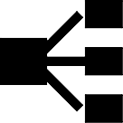
    </td>
    <td style="border: 0">
        <h3>Filtri</h3>
        
Questo progetto presenta una semplice configurazione del grafico da utilizzare come filtro in altri grafici. <a href="/help/compositing-graphs/nodes-reference-for-com/node-library/filters/filters.md">I filtri</a> sono nodi che modificano e/o fondono una o più immagini di input.

        
<i>Versione minima: 12.3.0</i>

    </td>
    <td style="border: 0; vertical-align: top; padding-top: 30px" width="128">
        
    </td>
</tr>

## Esempio: funzioni nei grafici a Substance {#sample-functions-in-sbs-graphs}

<tr style="border: 0">
    <td style="border: 0; vertical-align: top; padding-top: 30px" width="128">
        
    </td>
    <td style="border: 0">
        <h3>Funzioni nei grafici a Substance</h3>
        
Questo progetto funge da introduzione generale ai grafici a funzione e a come possono essere utilizzati per espandere il controllo disponibile sui parametri del nodo in <a href="/help/compositing-graphs/substance-compositing-graphs.md">Substance grafici</a>.

        
<i>Versione minima: 12.3.0</i>

    </td>
    <td style="border: 0; vertical-align: top; padding-top: 30px" width="128">
        
    </td>
</tr>

## Esempio: Elaboratore pixel {#sample-pixel-processor}

<tr style="border: 0">
    <td style="border: 0; vertical-align: top; padding-top: 30px" width="128">
        
    </td>
    <td style="border: 0">
        <h3>Elaboratore pixel</h3>
        
Il nodo <a href="/help/compositing-graphs/nodes-reference-for-com/atomic-nodes/pixel-processor/pixel-processor.md">Elaboratore pixel</a> è uno dei nodi più complessi ma potenti di Designer e la comprensione del suo funzionamento sblocca una notevole quantità di potenza e flessibilità nei grafici, che consente di creare nodi personalizzati più vari.

        
In questo progetto vengono illustrati due semplici casi d'uso per l'Elaboratore pixel: come generatore e come filtro. È anche un passo avanti per fare di più con <a href="/help/function-graphs/function-graphs.md">grafici di funzione</a>.

        
<i>Versione minima: 12.3.0</i>

    </td>
    <td style="border: 0; vertical-align: top; padding-top: 30px" width="128">
        
    </td>
</tr>

## Esempio: tessuto ornato {#sample-ornate-fabric}

<tr style="border: 0">
    <td style="border: 0; vertical-align: top; padding-top: 30px" width="128">
        
    </td>
    <td style="border: 0">
        <h3>Tessuto ornato</h3>
        
Questo progetto utilizzato nella nostra serie di esercitazioni </a> "Guida introduttiva" di <a href="../getting-started/getting-started.md"> illustra come creare un materiale di struttura con un motivo decorato utilizzando varie tecniche. Il modello è compilato in un <a href="/help/learning-tutorials/essentials/glossary/glossary.md#subgraph">grafico secondario</a>.

        
<i>Versione minima: 13.0.0</i>

    </td>
    <td style="border: 0; vertical-align: top; padding-top: 30px" width="128">
        
    </td>
</tr>

## Esempio: ereditarietà {#sample-inheritance}

<tr style="border: 0">
    <td style="border: 0; vertical-align: top; padding-top: 30px" width="128">
        
    </td>
    <td style="border: 0">
        <h3>Ereditarietà</h3>
        
In questo progetto vengono illustrati i metodi <a href="/help/learning-tutorials/essentials/glossary/glossary.md#inheritance">ereditarietà</a> disponibili nei grafici Substance per propagare importanti informazioni sull'immagine, ad esempio la risoluzione e la profondità di bit, tra i nodi di un grafico.

Ulteriori informazioni: <a href="/help/compositing-graphs/inheritance-compositing/inheritance-in-substance-compositing-graphs.md">Ereditarietà nei grafici delle Substance</a>

        
<i>Versione minima: 12.3.0</i>

    </td>
    <td style="border: 0; vertical-align: top; padding-top: 30px" width="128">
        
    </td>
</tr>

## Esempio: tessuto astratto {#sample-abstract-fabric}

<tr style="border: 0">
    <td style="border: 0; vertical-align: top; padding-top: 30px" width="128">
        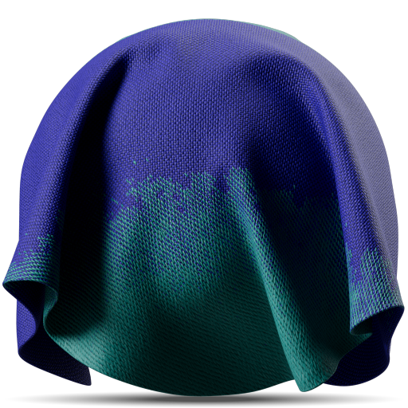
    </td>
    <td style="border: 0">
        <h3>Tessuto astratto</h3>
        
Modello per un semplice materiale in tessuto. In questo modello viene illustrato come creare un'intreccio semplice dettagliata utilizzando Tili Generator e campionatori di porzioni e come unire diversi pattern.

        
<i>Versione minima: 15.1.0</i>

    </td>
    <td style="border: 0; vertical-align: top; padding-top: 30px" width="128">
        
    </td>
</tr>

## Esempio: muro di mattoni {#sample-brick-wall}

<tr style="border: 0">
    <td style="border: 0; vertical-align: top; padding-top: 30px" width="128">
        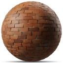
    </td>
    <td style="border: 0">
        <h3>Muro di mattoni</h3>
        
Modello per una semplice parete di mattoni con malta. In questo esempio viene illustrato come creare un materiale completo da un nodo di Tile Generator e vengono introdotti i nodi essenziali per l'utilizzo dei pattern di Affiancamento.

        
<i>Versione minima: 15.1.0</i>

    </td>
    <td style="border: 0; vertical-align: top; padding-top: 30px" width="128">
        
    </td>
</tr>

## Esempio: pelle {#sample-leather}

<tr style="border: 0">
    <td style="border: 0; vertical-align: top; padding-top: 30px" width="128">
        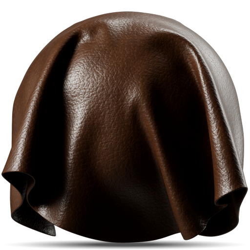
    </td>
    <td style="border: 0">
        <h3>Pelle</h3>
        
Modello per un semplice materiale in pelle. In questo modello viene illustrato come creare rapidamente una base in pelle realistica.

        
<i>Versione minima: 15.1.0</i>

    </td>
    <td style="border: 0; vertical-align: top; padding-top: 30px" width="128">
        
    </td>
</tr>

## Campione: Metallo {#sample-metal}

<tr style="border: 0">
    <td style="border: 0; vertical-align: top; padding-top: 30px" width="128">
        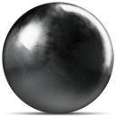
    </td>
    <td style="border: 0">
        <h3>Metallo</h3>
        
Modello per una semplice lamiera di materiale metallico. In questo esempio viene illustrato in che modo i canali Rugosità e Normale possono eseguire il sollevamento pesante in materiali altrimenti leggeri nelle caratteristiche, con il suo colore piatto e il height ma la finitura ricca.

        
<i>Versione minima: 15.1.0</i>

    </td>
    <td style="border: 0; vertical-align: top; padding-top: 30px" width="128">
        
    </td>
</tr>

## Esempio: satinato trapuntato {#sample-quilted-satin}

<tr style="border: 0">
    <td style="border: 0; vertical-align: top; padding-top: 30px" width="128">
        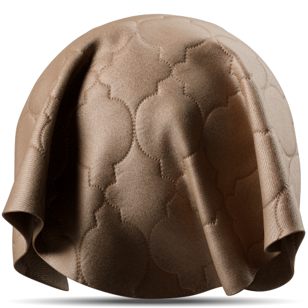
    </td>
    <td style="border: 0">
        <h3>Finitura lucida</h3>
        
Modello per un semplice materiale satinato trapuntato. In questo modello viene illustrato come creare un'intreccio intricato utilizzando Tili Generator e come dispersione i punti lungo una spline. Inoltre, utilizza un pratico trucco per le maschere di impacchettamento nei canali RGB per ottimizzare i flussi di lavoro di dispersione delle forme.

        
<i>Versione minima: 15.1.0</i>

    </td>
    <td style="border: 0; vertical-align: top; padding-top: 30px" width="128">
        
    </td>
</tr>

## Campione: plastica riciclata {#sample-recycled-plastic}

<tr style="border: 0">
    <td style="border: 0; vertical-align: top; padding-top: 30px" width="128">
        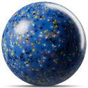
    </td>
    <td style="border: 0">
        <h3>Plastica riciclata</h3>
        
Modello per un semplice materiale plastico colorato. In questo modello viene illustrata una configurazione di base per eseguire rapidamente iterazioni nelle varianti colore utilizzando i nodi della tavolozza dei colori.

        
<i>Versione minima: 15.1.0</i>

    </td>
    <td style="border: 0; vertical-align: top; padding-top: 30px" width="128">
        
    </td>
</tr>

## Esempio: bulloni arrugginiti {#sample-rusty-bolts}

<tr style="border: 0">
    <td style="border: 0; vertical-align: top; padding-top: 30px" width="128">
        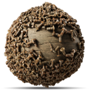
    </td>
    <td style="border: 0">
        <h3>Bulloni arrugginiti</h3>
        
Modello per una superficie cosparsa di bulloni arrugginiti. Questo modello introduce i nodi SDF e i nodi V2 dello splatter Shape con tecniche di dispersione avanzate, rotazione 3D dei pattern e mappatura delle texture su ogni singolo pattern.

        
<i>Versione minima: 15.1.0</i>

    </td>
    <td style="border: 0; vertical-align: top; padding-top: 30px" width="128">
        
    </td>
</tr>

## Campione: Pietra macinata {#sample-stone-ground}

<tr style="border: 0">
    <td style="border: 0; vertical-align: top; padding-top: 30px" width="128">
        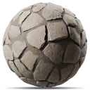
    </td>
    <td style="border: 0">
        <h3>Terreno in pietra</h3>
        
Modello per un materiale di base in pietra con lavoro dettagliato sul Height. Questo modello illustra flussi di lavoro più avanzati per aggiungere variazioni in un pattern con nodi di Flood Fill, modificare i rumori e utilizzare i dati di height per estrarre le maschere.

        
<i>Versione minima: 15.1.0</i>

    </td>
    <td style="border: 0; vertical-align: top; padding-top: 30px" width="128">
        
    </td>
</tr>

## Esempio: mosaico stilizzato {#sample-stylized-mosaic}

<tr style="border: 0">
    <td style="border: 0; vertical-align: top; padding-top: 30px" width="128">
        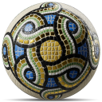
    </td>
    <td style="border: 0">
        <h3>Mosaico stilizzato</h3>
        
Modello per un materiale mosaico. Questo modello introduce i nodi spline e spiega come utilizzare dati spline come UV e height per distribuire pattern su forme complesse. Vengono inoltre utilizzati numerosi trucchi per estrarre e utilizzare le maschere in un grafico.

        
<i>Versione minima: 15.1.0</i>

    </td>
    <td style="border: 0; vertical-align: top; padding-top: 30px" width="128">
        
    </td>
</tr>

## Esempio: legno {#sample-wood}

<tr style="border: 0">
    <td style="border: 0; vertical-align: top; padding-top: 30px" width="128">
        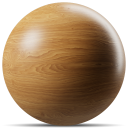
    </td>
    <td style="border: 0">
        <h3>Legno</h3>
        
Modello per un semplice materiale di sezione in legno. Questo campione è ricco di trucchi e tecniche utili, in particolare per la costruzione di vene di legno, e riesce a creare un legno realistico mantenendo la luce del grafico.

        
<i>Versione minima: 15.1.0</i>

    </td>
    <td style="border: 0; vertical-align: top; padding-top: 30px" width="128">
        
    </td>
</tr>
