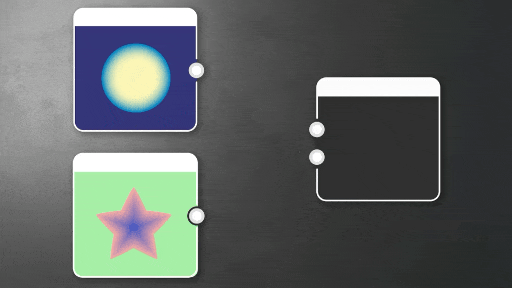

# Spostamento casuale canali

<table>
<tr style="border: 0;">
<td width="33.33%" style="border: 0;" valign="top">

</td>
<td style="border: 0;" valign="top">

Riordina i canali colore di una o due immagini di input nell’immagine di output.

Cioè, prende due input e ti consente di restituire un output in cui uno qualsiasi dei Canali alfa Rosso, Verde, Blu e Rosso sono scambiati o impostati su uno qualsiasi dei canali dall&#39;input.

Essenzialmente consente di imballare e scambiare i canali di RGB in qualsiasi modo possibile. Gli input in scala di grigi vengono trattati come se fossero Colore: rosso, verde, blu e Alpha restituiscono tutti gli stessi valori.

</td>
</tr>
</table>

Lo slittamento dei canali include opzioni di base, ma nella maggior parte dei casi è più rapido utilizzare [Unione RGBA](../../../../compositing-graphs/nodes-reference-for-com/node-library/filters/channels/rgba-merge/rgba-merge.md), [Divisione RGBA](../../../../compositing-graphs/nodes-reference-for-com/node-library/filters/channels/rgba-split/rgba-split.md), [Unione Alpha](../../../../compositing-graphs/nodes-reference-for-com/node-library/filters/channels/alpha-merge/alpha-merge.md) e [Divisione Alpha](../../../../compositing-graphs/nodes-reference-for-com/node-library/filters/channels/alpha-split/alpha-split.md) in Canali alfa di striping e impostazione dei canali. Sono configurati per eseguire azioni predefinite che non richiedono la modifica di più parametri e la successiva conversione in scala di grigi. Se stai cercando una versione più avanzata con più opzioni di fusione, guarda [Miscelatore canale](../../../../compositing-graphs/nodes-reference-for-com/node-library/filters/adjustments/channel-mixer/channel-mixer.md).

## Parametri

|  |  |
| --- | --- |
| <b>Canale rosso</b> *Numero intero* | Scegliete il canale sorgente da inserire nel canale Rosso dell’immagine di output. |
| <b>Canale verde</b> *Numero intero* | Scegliete il canale sorgente da inserire nel canale verde dell’immagine di output. |
| <b>Canale blu</b> *Numero intero* | Scegliete il canale sorgente da inserire nel canale blu dell’immagine di output. |
| <b>Canale alfa</b> *Numero intero* | Scegliete il canale sorgente da inserire nel Canale alfa dell’immagine di output. |

## Connettori di ingresso

|  |  |
| --- | --- |
| <b>Input 1</b> *Colore/Scala di grigi* PRIMARIO | Immagine di input principale. |
| <b>Input 2</b> *Colore/Scala di grigi* | Immagine di input secondaria. |

## Esempi

*Disponibile a breve.*
