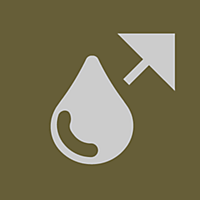
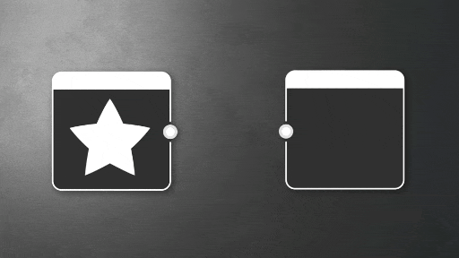
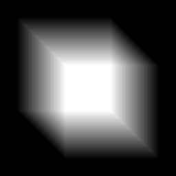

# Sfocatura direzionale

<table>
<tr style="border: 0;">
<td style="border: 0; width:33.33%; vertical-align:top" width="33.33%" valign="top">

{width="100%"}

<b>In:</b> Nodi Atomici

</td>
<td style="border: 0; width:66.66%; vertical-align:top" width="66.66%" valign="top">

Applica la sfocatura in una direzione specifica in base a una mappa di intensità.

Questo nodo esegue un&#39;operazione simile a un effetto movimento su un input. A differenza del normale nodo &#39;[Sfocatura](../../../../compositing-graphs/nodes-reference-for-com/atomic-nodes/blur/blur.md)&#39;, che sfoca in modo uniforme in tutte le direzioni, &#39;Sfocatura direzione&#39; funziona seguendo un angolo definito dall&#39;utente.

</td>
</tr>
</table>

<table>
<tr style="border: 0">
<td style="border: 0; width: 15%" width="15%"></td>
<td style="border: 0; text-align: center" align="center"></td>
<td style="border: 0; width: 15%" width="15%"></td>
</tr>
</table>

Simile alla funzione &quot;Sfoca&quot;, offre un&#39;operazione più veloce e di bassa qualità. In [Sfocatura anisotropa](../../../../compositing-graphs/nodes-reference-for-com/node-library/filters/blurs/anisotropic-blur/anisotropic-blur.md) è disponibile un&#39;alternativa estesa e di qualità superiore, con un compromesso tra prestazioni e prestazioni

## Sfocatura direzionale e anisotropa

Le immagini seguenti mostrano la sfocatura direzionale e la [sfocatura anisotropa](../../../../compositing-graphs/nodes-reference-for-com/node-library/filters/blurs/anisotropic-blur/anisotropic-blur.md) applicate alla stessa forma di input, con parametri simili. L’opzione Sfocatura anisotropa è impostata su anisotropia completa e alta qualità.

<table>
<tr style="border: 0;">
<td style="border: 0;" valign="top">

<b>Sfocatura direzionale</b>

{zoomable="yes"}

</td>
<td style="border: 0;" valign="top">

<b>Sfocatura anisotropa</b>

{zoomable="yes"}

</td>
</tr>
</table>

## Parametri

|  |  |
| --- | --- |
| <b>Intensità</b> *Mobile* | Imposta il raggio di sfocatura in pixel. |
| <b>Angolo</b> *Mobile* | La direzione dell’effetto di sfocatura in numero di giri in senso orario, a partire da orizzontale, ad esempio vettore di direzione (1, 0). |

## Connettori di ingresso

|  |  |
| --- | --- |
| <b>Input</b> *Scala di grigi/Colore* [PRIMARIO](../../../../glossary/glossary.md) | Immagine da elaborare. |

## Esempi

*Disponibile a breve.*
