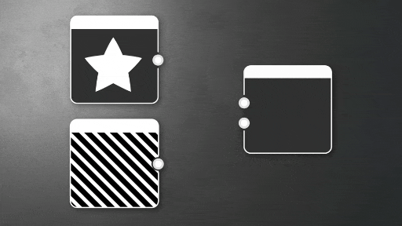
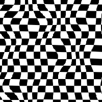
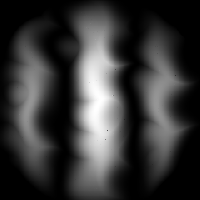
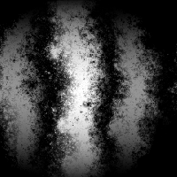

# Alterazione direzionale

<table>
<tr style="border: 0;">
<td width="33.33%" style="border: 0;" valign="top">

</td>
<td style="border: 0;" valign="top">

Sposta i pixel in una direzione specifica in base a una mappa di intensità, con possibile deformazione.

Altera un input nella direzione impostata dall’utente, moltiplicato per una mappa di intensità impostata dall’utente. Funziona in modo simile a Altera, ma solo in una direzione specifica.

</td>
</tr>
</table>

Il nodo Altera è un nodo semplice ma utile che può essere utilizzato come base per altri effetti più avanzati. Ci sono alternative più avanzate, ad esempio altri nodi correlati di interesse sono [Sfocatura Pendenza](../../../../compositing-graphs/nodes-reference-for-com/node-library/filters/blurs/slope-blur/slope-blur.md) e [Alterazione vettoriale](../../../../compositing-graphs/nodes-reference-for-com/node-library/filters/effects/vector-warp/vector-warp.md).

## Parametri

|  |  |
| --- | --- |
| <b>Intensità</b> *Mobile* | Consente di impostare l’intensità dell’alterazione. |
| <b>Angolo di alterazione</b> *Mobile* | Imposta l’angolo dell’effetto di alterazione, in numero di giri. |
| <b>Modalità filtro input</b> *Booleano* | Controlla se per il campionamento dell&#39;<b>input</b> viene utilizzato il filtro più vicino o bilineare. |
| <b>Offset mappa intensità</b> *Mobile* | Questo valore viene sottratto dai valori dell&#39;immagine <b>di input intensità</b>. |

## Connettori di ingresso

|  |  |
| --- | --- |
| <b>Input</b> *Scala di grigi/Colore* PRIMARIO | L’immagine in scala di grigio o a colori di input sulla quale deve essere applicato l’effetto di alterazione. |
| <b>Input intensità</b> *Scala di grigi* | Immagine in scala di grigio che definisce la quantità di alterazione da applicare all&#39;immagine <b>Input</b>. |

## Esempi

<table>
<tr style="border: 0;">
<td style="border: 0;" valign="top">

{zoomable="yes"}

</td>
<td style="border: 0;" valign="top">

{zoomable="yes"}

</td>
<td style="border: 0;" valign="top">

{zoomable="yes"}

</td>
</tr>
</table>
