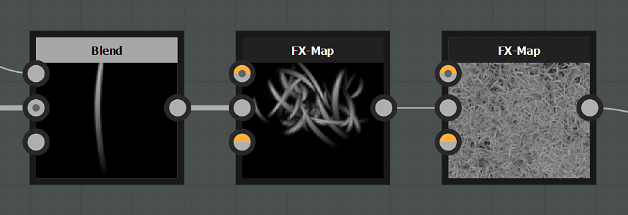

# FX-Map

<table>
<tr style="border: 0;">
<td style="border: 0; width:33.33%; vertical-align:top" width="33.33%" valign="top">

{width="100%"}

<b>In:</b> Nodi Atomici

</td>
<td style="border: 0; width:66.66%; vertical-align:top" width="66.66%" valign="top">

FX-Map è in grado di replicare e suddividere un&#39;immagine o un pattern di input più e più volte, e controllare la distribuzione di ogni pattern grazie a parametri e funzioni logiche.

È uno dei nodi atomici più potenti, nonché il nodo più complesso disponibile nell&#39;applicazione.

</td>
</tr>
</table>

<table>
<tr style="border: 0">
<td style="border: 0; width: 15%" width="15%"></td>
<td style="border: 0; text-align: center" align="center"></td>
<td style="border: 0; width: 15%" width="15%"></td>
</tr>
</table>

Analogamente all&#39;[Elaboratore pixel](../../../../compositing-graphs/nodes-reference-for-com/atomic-nodes/pixel-processor/pixel-processor.md), spetta a te definire e creare le funzioni che determinano il comportamento e l&#39;output di questo nodo.

>[!TIP]
>
> Date un&#39;occhiata alla [guida dedicata](../../../../function-graphs/fxmaps/fxmaps.md) per ulteriori informazioni sul processo FX-Map.

>[!IMPORTANT]
>
> Si consiglia di avere familiarità con tutti gli aspetti del software e di non avere problemi a creare [funzioni matematiche](../../../../function-graphs/function-graphs.md) per i parametri prima di tentare di utilizzare il nodo FX-Map.

Tenete presente che, a differenza di altri nodi, la maggior parte del comportamento di FX-Map non è determinata dai parametri, ma [dalla modifica delle funzioni FX-Map](../../../../function-graphs/fxmaps/fxmaps.md) al suo interno.

|  |  |
| --- | --- |
| <b>Metodo colore</b> *Booleano* | Alterna tra un’immagine in scala di grigio e un’immagine a colori in output. Il colore sarà molto più lento della scala di grigi. |
| <b>Sfondo</b> *Virgola mobile/Virgola mobile4* | Imposta il colore iniziale dello sfondo su cui comporre i risultati. |
| <b>Area di rendering</b> *Virgola mobile 4* | Consente di impostare l’intervallo di pixel iniziale per ciascun lato dell’FX-Map, ottenendo così un effetto allungamento. |
| <b>Area Affiancamento</b> *Virgola mobile 4* | Consente di scostare la distanza di Affiancamento dell’FX-Map. |
| <b>Cull all&#39;esterno</b> *Booleano* | Esegue un&#39;ottimizzazione [eliminando](../../../../glossary/glossary.md) modelli che non rientrano nell&#39;intervallo normale. |
| <b>Rugosità</b> *Mobile* | Funge da moltiplicatore di profondità e opacità. Applica una distorsione al processo di fusione FX-map. |
| <b>Opacità globale</b> *Mobile* | Imposta l’opacità globale dell’output di FX-map. |

## Guida FX-Map

*Disponibile a breve.*

## Connettori di ingresso

|  |  |
| --- | --- |
| <b>Sfondo</b> *Scala di grigi/Colore* PRIMARIO | Il colore di sfondo dell&#39;immagine di output. |
| <b>Immagine di input n. </b> *Scala di grigi/Colore* |  |

## Esempi

