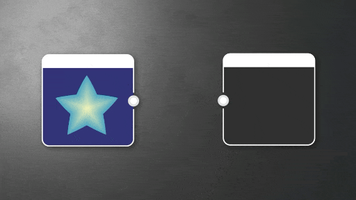

# HSL

<table>
<tr style="border: 0;">
<td width="33.33%" style="border: 0;" valign="top">

{width="100%"}

</td>
<td style="border: 0;" valign="top">

Regola tonalità, saturazione e luminosità di un’immagine a colori.

Si tratta di un nodo di base e facile da usare, molto utile quando si lavora con i dati a colori.

Se cercate altri modi per modificare i toni di un’immagine, osservate [Curva](../../../../compositing-graphs/nodes-reference-for-com/atomic-nodes/curve/curve.md), [Livelli](../../../../compositing-graphs/nodes-reference-for-com/atomic-nodes/levels/levels.md) e [Contrasto/Luminosità](../../../../compositing-graphs/nodes-reference-for-com/node-library/filters/adjustments/contrast-luminosity/contrast-luminosity.md).

</td>
</tr>
</table>

## Parametri

|  |  |
| --- | --- |
| <b>Tonalità</b> *Virgola mobile* | Determina il colore dell&#39;immagine di input.   I valori inferiori a 0,5 spostano la tonalità in modo negativo, mentre i valori superiori a 0,5 la spostano in modo positivo. |
| <b>Saturazione</b> *Virgola mobile* | Determina la saturazione del colore dell&#39;immagine di input.   I valori inferiori a 0,5 riducono la saturazione, mentre i valori superiori a 0,5 la aumentano. |
| <b>Luminosità</b> *Virgola mobile* | Determina la Luminosità dell&#39;immagine di input I valori inferiori a 0,5 riducono la Luminosità, mentre i valori superiori a 0,5 la aumentano. |

## Connettori di ingresso

|  |  |
| --- | --- |
| <b>Input</b> *Colore* PRIMARIO | Immagine da elaborare. |

## Esempi

*Disponibile a breve.*
