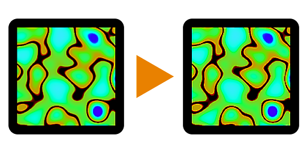

# Nitidezza

<table>
<tr style="border: 0;">
<td style="border: 0; width:33.33%; vertical-align:top">

<b>In:</b> Nodi Atomici

</td>
<td style="border: 0;" valign="top">

## Descrizione

Il nodo Nitidezza esegue un&#39;operazione di nitidezza su un input. È un nodo utile per applicare il tocco finale di nitidezza a un’immagine.

</td>
</tr>
</table>

<table>
<tr style="border: 0">
<td style="border: 0; width: 15%"></td>
<td style="border: 0; text-align: center"></td>
<td style="border: 0; width: 15%"></td>
</tr>
</table>

È matematicamente molto simile alla Maschera di contrasto di Photoshop, nonostante il nome sia diverso. Funziona bene per cose come una mappa Basecolor, ma dovrebbe essere evitata su mappe come Mappe normali e mappe Metallic.

## Input

<b>Input</b> *Colore/Scala Di Grigi* (Principale)\
L&#39;immagine da rendere più nitida.

## Parametri

<b>Intensità</b> *Virgola mobile*\
Consente di impostare l’intensità dell’effetto nitidezza.

<b>Alpha Punchthrough</b> *Booleano* (disponibile quando un&#39;immagine a colori è collegata all&#39;<b>Input</b>)\
Determina se il canale alfa dell&#39;immagine deve essere reso più nitido o lasciato inalterato.

## Esempi

