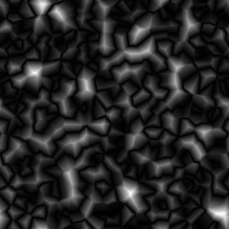
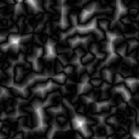

# Cristallo 1

<table>
<tr style="border: 0;">
<td width="33.33%" style="border: 0;" valign="top">

{width="128px"}

<b>Ingresso:</b> Generatori di Texture > Rumori

</td>
<td width="100.00%" style="border: 0;" valign="top">

## Descrizione

Genera un disturbo di tipo Worlye Voronoi, con una metrica della distanza leggermente più angular. Può essere utile per alcuni scopi angular e geometrici.

</td>
</tr>
</table>

## Parametri

|  |  |
|:---|:---|
| <b>Scala</b> <i>1 - 256</i> | Imposta la scala globale per l’effetto. |
| <b>Disturbo</b> <i>0.0 - 1.0</i> | Fase-sposta il disturbo per introdurre piccole variazioni. |
| <b>Non square expansion</b> <i>Falso/Vero</i> | Consente la compensazione di schiacciamento e allungamento con rapporti non quadrati. |

## Esempi

<table style="table-layout:fixed">
    <tr style="border: 0;">
        <td style="border: 0;">
            
        </td>
        <td style="border: 0;"></td>
        <td style="border: 0;"></td>
    </tr>
</table>
