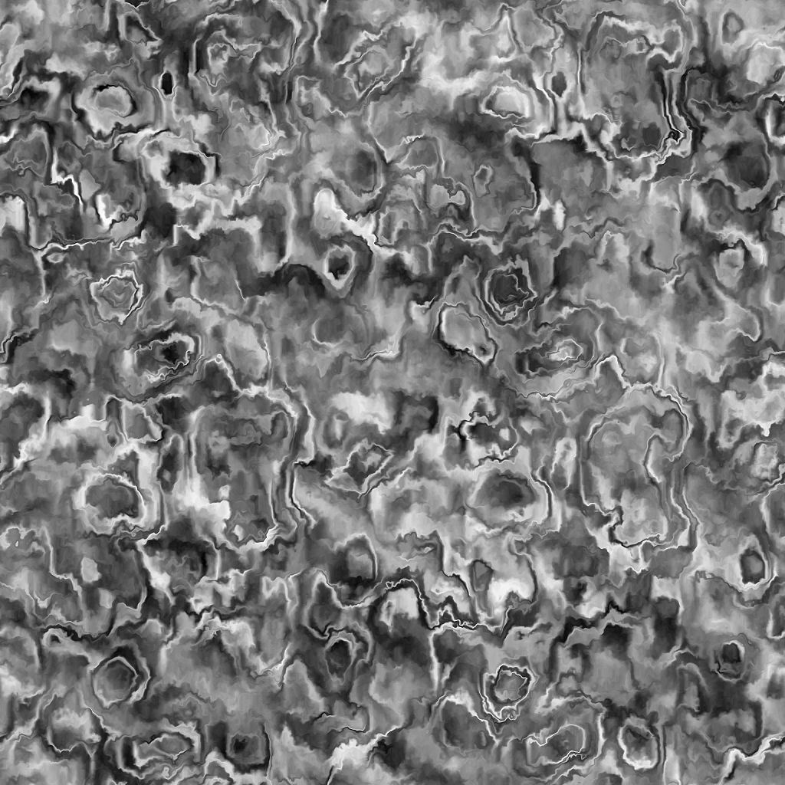
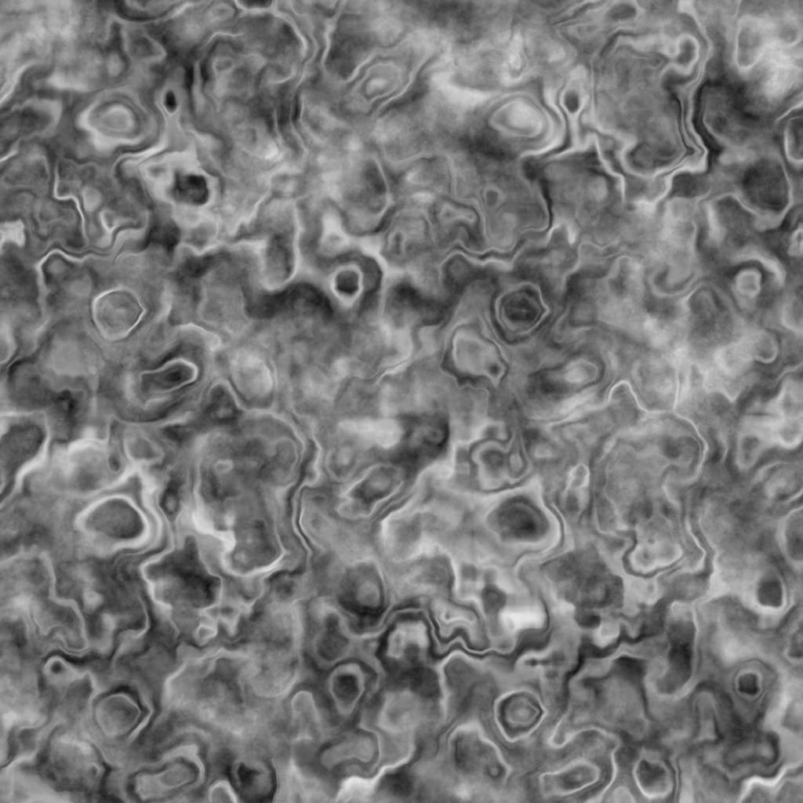
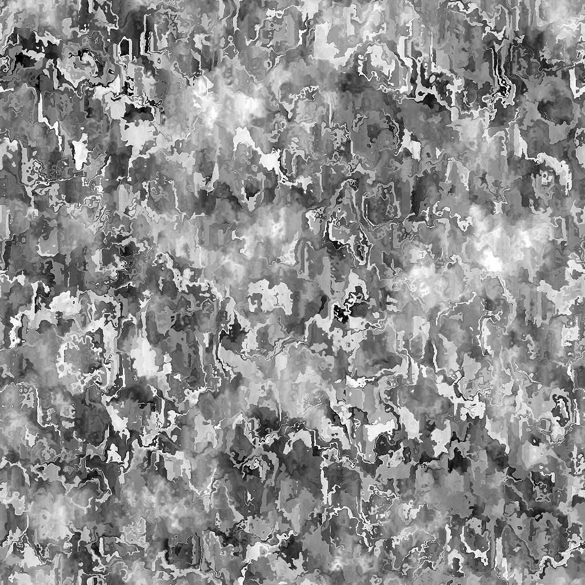

# Grunge Galvanica Piccola

<table>
<tr style="border: 0;">
<td width="33.33%" style="border: 0;" valign="top">

{width="200px"}

<b>Ingresso:</b> Generatori di texture > Rumori

</td>
<td width="100.00%" style="border: 0;" valign="top">

## Descrizione

Il nodo **Grunge Galvanica Piccola** genera una mappa di grunge simile al modello dell&#39;acciaio densamente galvanizzato.

</td>
</tr>
</table>

## Parametri

|  |  |
|:---|:---|
| <b>Saldo</b> <i>Mobile</i> | Regola il bilanciamento tra i valori di luminosità e oscurità. |
| <b>Contrasto</b> <i>Mobile</i> | Regola il contrasto dell’immagine. |
| <b>Inverti</b> <i>Booleano</i> | Inverte l&#39;output dell&#39;immagine utilizzando un&#39;operazione `1-x`. |
| <b>Non square expansion</b> <i>Booleano</i> | Consente la compensazione di schiacciamento e allungamento con rapporti non quadrati. |
| <b>Avanzate</b> |  |
| <b>Nitidezza</b> <i>Mobile</i> | Regola la nitidezza e la nitidezza delle forme galvanizzate. |
| <b>Dirt</b> <i>Mobile</i> | Regola l’opacità della sovrapposizione del dirt. |
| <b>Micro Distorsione</b> <i>Mobile</i> | Regola l’intensità dell’effetto di alterazione ad alta frequenza. |

## Esempi

<table style="table-layout:fixed">
    <tr style="border: 0;">
        <td style="border: 0;">
            
        </td>
        <td style="border: 0;">
            
        </td>
        <td style="border: 0;"></td>
    </tr>
</table>
