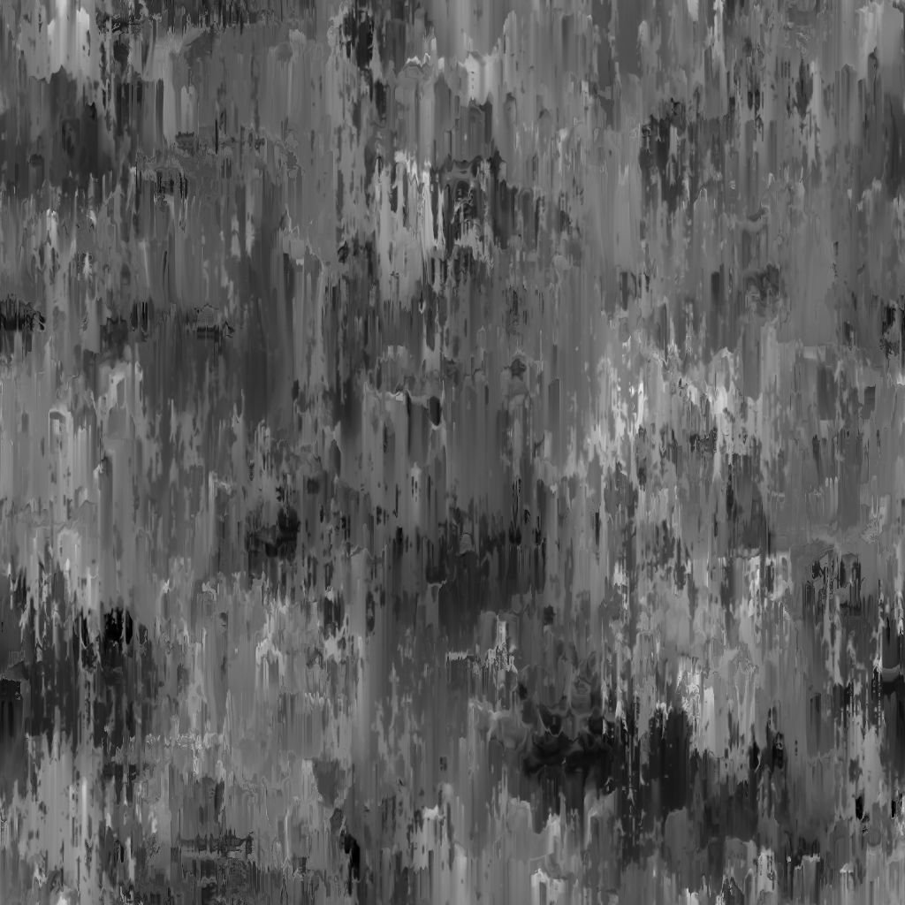
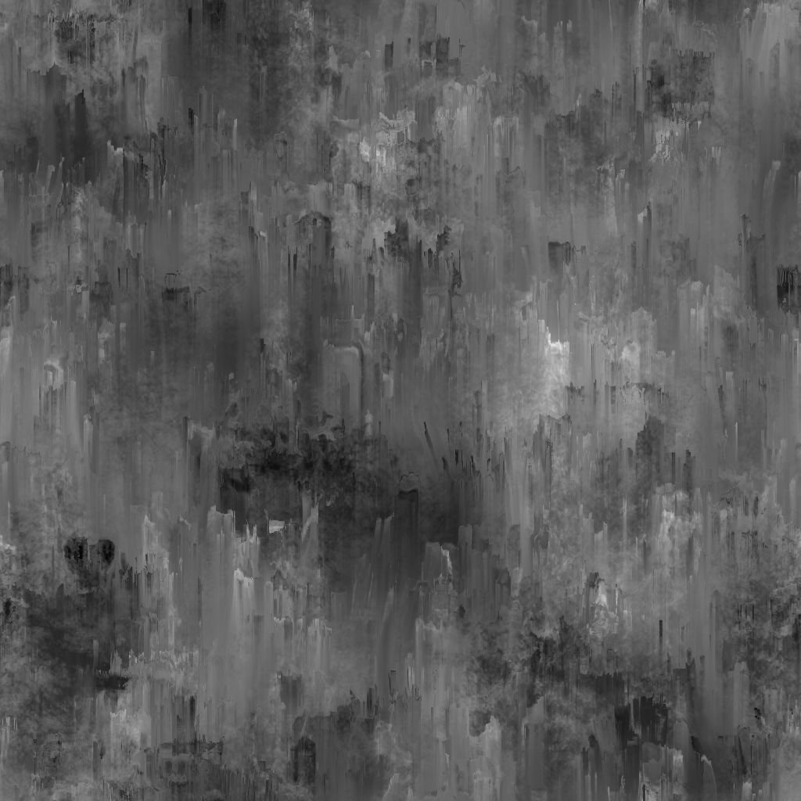
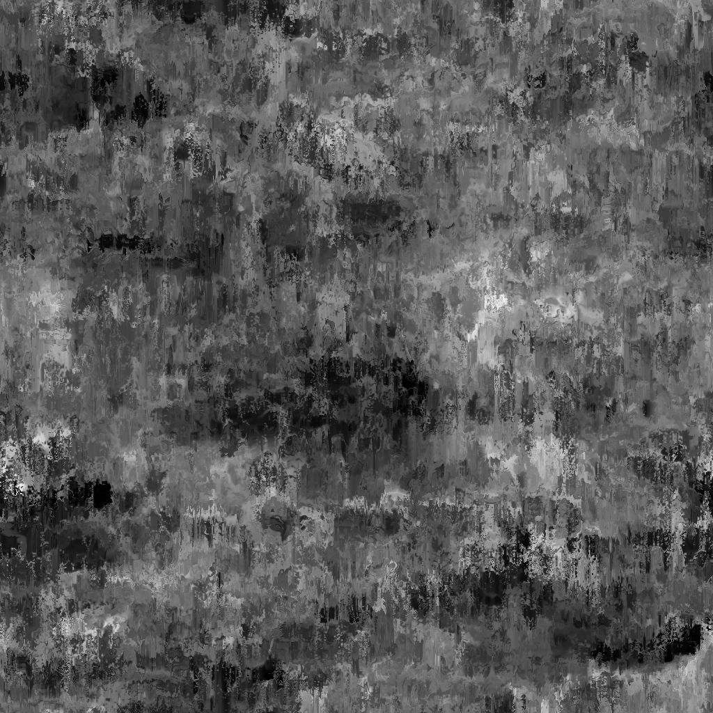

# Vernice a perdita di grunge

<table>
<tr style="border: 0;">
<td width="33.33%" style="border: 0;" valign="top">

{width="200px"}

<b>Ingresso:</b> Generatori di texture > Rumori

</td>
<td width="100.00%" style="border: 0;" valign="top">

## Descrizione

Il nodo **Pittura con perdita di Grunge** genera una mappa di grunge simile alla pittura che gocciola attraverso le perdite.

</td>
</tr>
</table>

## Parametri

|  |  |
|:---|:---|
| <b>Saldo</b> <i>Mobile</i> | Regola il bilanciamento tra i valori di luminosità e oscurità. |
| <b>Contrasto</b> <i>Mobile</i> | Regola il contrasto dell’immagine. |
| <b>Inverti</b> <i>Booleano</i> | Inverte l&#39;output dell&#39;immagine utilizzando un&#39;operazione `1-x`. |
| <b>Non square expansion</b> <i>Booleano</i> | Consente la compensazione di schiacciamento e allungamento con rapporti non quadrati. |
| <b>Avanzate</b> |  |
| <b>Intensità perdita</b> <i>Mobile</i> | Regola la densità e l’intensità delle gocce. |
| <b>Scala Di Perdita</b> <i>Numero intero</i> | Regola la scala della separazione delle gocce. |
| <b>Angolo di perdita casuale</b> <i>Mobile</i> | Regola l&#39;*angolo massimo* gocce che possono essere ruotate casualmente in *numero di giri*. |
| <b>Perdita di nitidezza</b> <i>Mobile</i> | Regola la nitidezza e la nitidezza delle gocce. |

## Esempi

<table style="table-layout:fixed">
    <tr style="border: 0;">
        <td style="border: 0;">
            
        </td>
        <td style="border: 0;">
            
        </td>
        <td style="border: 0;"></td>
    </tr>
</table>
