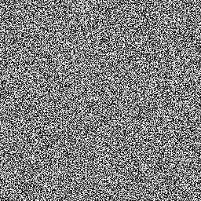
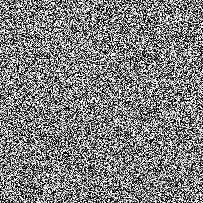

# Disturbo bianco rapido

<table>
<tr style="border: 0;">
<td width="33.33%" style="border: 0;" valign="top">

{width="128px"}

<b>Ingresso:</b> Generatori di Texture > Rumori

</td>
<td width="100.00%" style="border: 0;" valign="top">

## Descrizione

Questa è una versione più veloce di [Disturbo bianco](../../../../../../compositing-graphs/nodes-reference-for-com/node-library/texture-generators/noises/white-noise/white-noise.md), per quando la qualità non è il tuo problema principale e desideri risparmiare un po&#39; sulle prestazioni. Nella maggior parte dei casi, questa versione veloce è adatta alle tue esigenze.

</td>
</tr>
</table>

## Esempi

<table style="table-layout:fixed">
    <tr style="border: 0;">
        <td style="border: 0;">
            
        </td>
        <td style="border: 0;"></td>
        <td style="border: 0;"></td>
    </tr>
</table>
