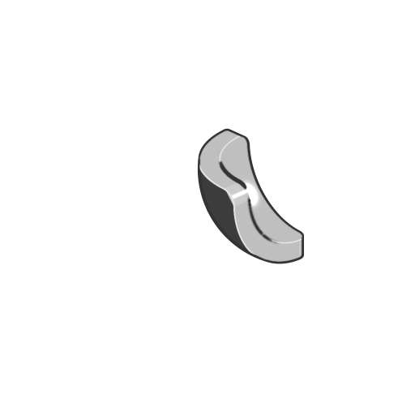

# Superficie di intersezione

<table>
<tr style="border: 0;">
<td width="33.33%" style="border: 0;" valign="top">

<b>In:</b> Funzione SDF > Operatore

</td>
<td width="100.00%" style="border: 0;" valign="top">

## Descrizione

Restituisce la superficie della porzione di una forma SDF di base intersecata da un&#39;altra forma SDF, con thickness regolabile.

</td>
</tr>
</table>

>[!INFO]
> 
> Per ulteriori informazioni sui concetti e i flussi di lavoro relativi alla Funzione SDF, consulta la pagina dedicata: [Utilizzo della Funzione SDF](../../working-with-sdf-functions.md)

## Input

|  |  |
| :--- | :--- |
| <b>SDF di base</b> *Virgola mobile* | Forma SDF su cui è basata la superficie risultante. |
| <b>SDF intersecante</b> *Virgola mobile* | La forma SDF che interseca la forma SDF di base. |
| <b>Thickness</b> *Virgola mobile* | Thickness della superficie risultante.  <i>Impostazione predefinita: 0.02</i> |
