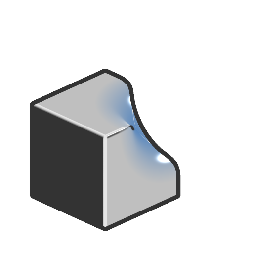

# Sottrazione uniforme

<table>
<tr style="border: 0;">
<td width="33.33%" style="border: 0;" valign="top">

<b>In:</b> Funzione SDF > Operatore

</td>
<td width="100.00%" style="border: 0;" valign="top">

## Descrizione

Sottrae il volume della forma SDF 1 dalla forma SDF 2, con un arrotondamento regolabile applicato all&#39;intersezione delle due forme.

</td>
</tr>
</table>

>[!INFO]
> 
> Per ulteriori informazioni sui concetti e i flussi di lavoro relativi alla Funzione SDF, consulta la pagina dedicata: [Utilizzo della Funzione SDF](../../../../../../learning-tutorials/nodes/working-with-sdf-functions/working-with-sdf-functions.md)

## Input

|  |  |
| :--- | :--- |
| <b>SDF 1</b> *Virgola mobile* | Forma SDF da cui viene sottratta. |
| <b>SDF 2</b> *Virgola mobile* | La forma SDF viene sottratta dalla forma SDF 1. |
| <b>Smoothness</b> *Virgola mobile* | Attenuazione applicata all&#39;intersezione delle due forme.  <i>Nota:</i> i bordi netti possono apparire nel punto di intersezione dei raggi di attenuazione. |
