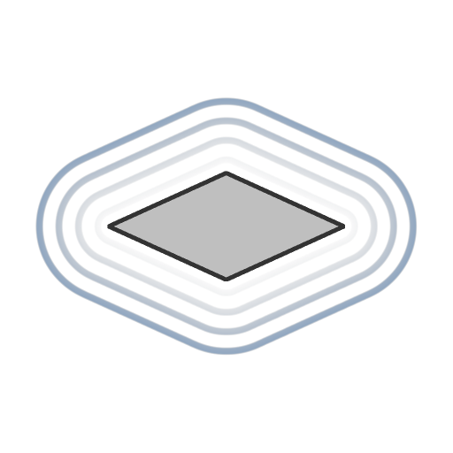

# Piano infinito

<table>
<tr style="border: 0;">
<td width="33.33%" style="border: 0;" valign="top">

<b>In:</b> Funzione SDF > Primitiva

</td>
<td width="100.00%" style="border: 0;" valign="top">

## Descrizione

Funzione SDF per un piano infinito con orientamento e posizione regolabili.

</td>
</tr>
</table>

>[!INFO]
> 
> Per ulteriori informazioni sui concetti e i flussi di lavoro relativi alla Funzione SDF, consulta la pagina dedicata: [Utilizzo della Funzione SDF](../../working-with-sdf-functions.md)

## Input

|  |  |
| :--- | :--- |
| <b>Normale</b> *Virgola mobile 3* | Il vettore normale dello spazio mondo del piano infinito, che ne controlla l&#39;orientamento. Il vettore è normalizzato.  <i>Impostazione predefinita: (0, 0, 1)</i> |
| <b>Posizione centrale</b> *Virgola mobile* | Posizione nello spazio mondo del perno del piano, come distanza dall&#39;origine del mondo lungo la normale del piano.  <i>Impostazione predefinita: 0</i> |
| <b>P</b> *Virgola mobile 3* | La posizione Trasforma nello spazio mondiale. Utilizza questo input per applicare trasformazioni aggiuntive utilizzando i nodi <b>Offset P</b> e <b>Rotazione P</b>.  <i>Impostazione predefinita: la posizione dello spazio globale non trasformata.</i> |
