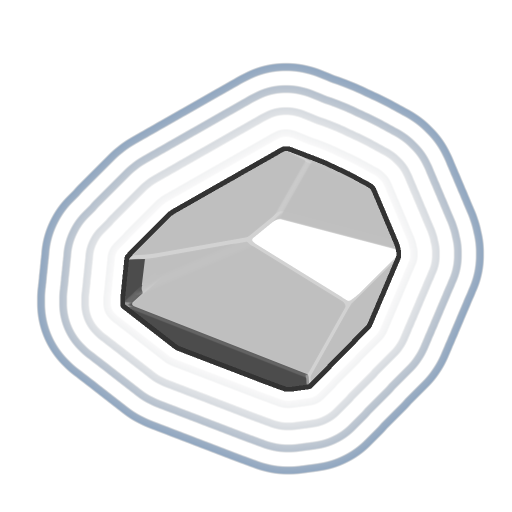

# Rock

<table>
<tr style="border: 0;">
<td width="33.33%" style="border: 0;" valign="top">

<b>In:</b> Funzione SDF > Primitiva

</td>
<td width="100.00%" style="border: 0;" valign="top">

## Descrizione

Una Funzione SDF per una forma rocciosa parametrica e casuale, costruita con Funzioni SDF.

</td>
</tr>
</table>

>[!INFO]
> 
> Per ulteriori informazioni sui concetti e i flussi di lavoro relativi alla Funzione SDF, consulta la pagina dedicata: [Utilizzo della Funzione SDF](../../../../../../learning-tutorials/nodes/working-with-sdf-functions/working-with-sdf-functions.md)

## Input

|  |  |
| :--- | :--- |
| <b>Max. facet</b> *Numero intero* | Numero massimo di sfaccettature della roccia (fino a 32).  <i>Impostazione predefinita: 8</i> |
| <b>Smoothness</b> *Virgola mobile* | Raggio degli archi arrotondati applicato ai bordi della roccia.  <i>Impostazione predefinita: 0</i> |
| <b>Casualità</b> *Virgola mobile* | Modifica l&#39;orientamento e la distanza delle facce rispetto al centro. Di conseguenza, valori maggiori producono una roccia più piccola.  <i>Impostazione predefinita: 0</i> |
| <b>Valore di inizializzazione</b> *Virgola mobile* | Valore di inizializzazione per il parametro <b>Casualità</b>.  <i>Impostazione predefinita: 0</i> |
| <b>Scala</b> *Virgola mobile* | Scala globale della forma della roccia. Applicato dopo <b>Casualità</b> e prima di <b>Smoothness</b>.  <i>Impostazione predefinita: 0.5</i> |
| <b>Posizione centrale</b> *Virgola mobile 3* | Posizione dello spazio globale del perno della roccia.  <i>Impostazione predefinita: (0, 0, 0.5)</i> |
| <b>P</b> *Virgola mobile 3* | La posizione Trasforma nello spazio mondiale. Utilizza questo input per applicare trasformazioni aggiuntive utilizzando i nodi <b>Offset P</b> e <b>Rotazione P</b>. <i>Impostazione predefinita: la posizione dello spazio globale non trasformata.</i> |
