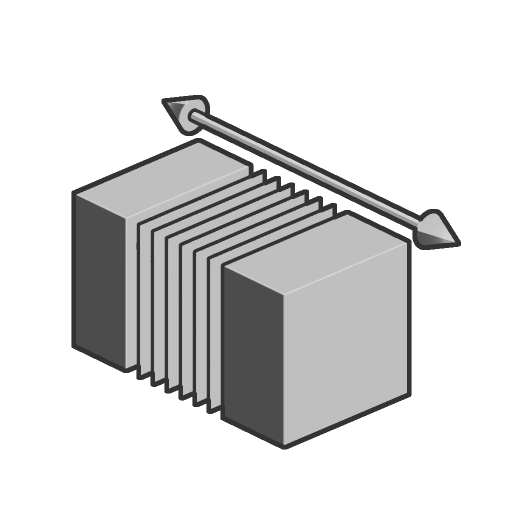

# Allungato

<table>
<tr style="border: 0;">
<td width="33.33%" style="border: 0;" valign="top">

<b>In:</b> Funzione SDF > Trasforma

</td>
<td width="100.00%" style="border: 0;" valign="top">

## Descrizione

Allungare una forma SDF da una posizione regolabile. In modo efficace e lineare, estende il volume di una forma SDF partendo da una sezione regolabile.

</td>
</tr>
</table>

>[!INFO]
> 
> Per ulteriori informazioni sui concetti e i flussi di lavoro relativi alla Funzione SDF, consulta la pagina dedicata: [Utilizzo della Funzione SDF](../../working-with-sdf-functions.md)

## Input

|  |  |
| :--- | :--- |
| <b>SDF</b> *Virgola mobile* | Forma SDF di input. |
| <b>Allungamento</b> *Virgola mobile 3* | Lunghezza dell’allungamento sugli assi X, Y e Z. |
| <b>Posizione centrale</b> *Virgola mobile 3* | Posizione dello spazio mondo da cui verrà allungata la forma. Ad esempio, la posizione della sezione allungata. |
| <b>P</b> *Virgola mobile 3* | La posizione Trasforma nello spazio mondiale. Utilizza questo input per applicare trasformazioni aggiuntive utilizzando i nodi <b>Offset P</b> e <b>Rotazione P</b>.  <i>Impostazione predefinita: la posizione dello spazio globale non trasformata.</i> |
