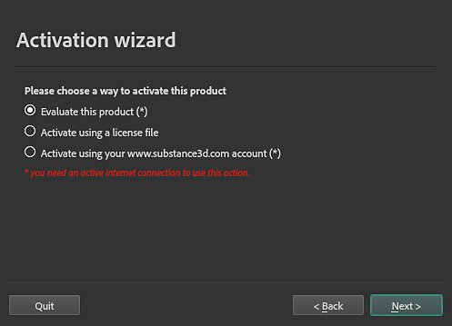

# Processo di attivazione per tipo di applicazione

Il processo di attivazione dipende da dove hai acquistato o hai accesso a Designer:

| Edizione | Processo di attivazione |
|:-----------------------------|:--------------------------------------------------------------------------------------------------------------------------------------------------------------------------------------------------------------------------------------------------------------------------------------------------------------------------------------------------------------------------------|
| Creative Cloud desktop (CCD) | Installa il prodotto dall&#39;app CCD, quindi avvialo. Visita queste pagine se riscontri problemi con la tua licenza: [Le app non verranno avviate a causa di un errore di abbonamento](https://helpx.adobe.com/it/creative-cloud/apps/troubleshoot/launch-issues/apps-wont-launch-due-to-subscription-error.html) / [Account, piani e Guida alla fatturazione](https://helpx.adobe.com/it/account/individual.html) |
| Vapore | Avvia il prodotto direttamente dalla libreria Steam. |
| Substance (indipendente) | Consulta il processo di attivazione descritto di seguito. |

## Passaggi di attivazione (edizione Substance)

### Utilizzo dell&#39;Attivazione guidata

Quando avvii Designer per la prima volta, l’Attivazione guidata si aprirà e ti guiderà attraverso la procedura di attivazione.

Sono disponibili tre opzioni:

* <b>Valutazione del prodotto</b>: le versioni di prova precedenti non sono più disponibili. Puoi invece avviare una versione di prova di 30 giorni per ogni applicazione Substance 3D [qui](https://www.adobe.com/creativecloud/3d-augmented-reality.html) o con Creative Cloud Desktop. Ogni versione di prova è indipendente dalle altre applicazioni Substance 3D, quindi puoi provarle una alla volta o tutte contemporaneamente.
* <b>Attivazione tramite un file di licenza</b>: attivare il prodotto con un file di licenza (<b>\*.key</b>) scaricato dalla pagina dell&#39;account nel [sito Web Substance 3D](https://store.substance3d.com/user) prima del 30 settembre 2022.
* <b>Attiva utilizzando il tuo account</b>: gli account Substance legacy non possono più essere utilizzati per l&#39;attivazione.

>[!IMPORTANT]
>
> Per installare il file di licenza con l&#39;Attivazione guidata, assicurati di eseguire Designer come amministratore e di disattivare temporaneamente l&#39;antivirus.

### Attivazione manuale

Puoi attivare manualmente Designer inserendo il file license.key nella seguente cartella:

<table data-preserve-html="true" style="table-layout:auto">
    <tbody>
        <tr>
            <th style="text-align: left;">Piattaforma</th>
            <th style="text-align: left;">Versione</th>
            <th colspan="2" style="text-align: left;">Percorso</th>
        </tr>
        <tr>
            <td rowspan="4" style="text-align: left;"><b>Windows</b></td>
            <td rowspan="2" style="text-align: left;"><b>11.2</b> o versione successiva</td>
            <td style="text-align: left;"><code>AppData&#92;Local</code></td>
            <td style="text-align: left;"><code>C:&#92;Users&#92;&#91;username&#93;&#92;AppData&#92;Local&#92;Adobe&#92;Adobe Substance 3D Designer</code></td>
        </tr>
        <tr>
            <td style="text-align: left;"><code>AppData&#92;Roaming</code></td>
            <td style="text-align: left;"><code>C:&#92;Users&#92;&#91;username&#93;&#92;AppData&#92;Roaming&#92;Adobe&#92;Adobe Substance 3D Designer</code></td>
        </tr>
        <tr>
            <td rowspan="2" style="text-align: left;"><b>11.1</b> o versioni precedenti</td>
            <td style="text-align: left;"><code>AppData&#92;Local</code></td>
            <td style="text-align: left;"><code>C:&#92;Users&#92;&#91;username&#93;&#92;AppData&#92;Local&#92;Allegorithmic&#92;Substance Designer</code></td>
        </tr>
        <tr>
            <td style="text-align: left;"><code>AppData&#92;Roaming</code></td>
            <td style="text-align: left;"><code>C:&#92;Users&#92;&#91;username&#93;&#92;AppData&#92;Roaming&#92;Allegorithmic&#92;Substance Designer</code></td>
        </tr>
        <tr>
            <td rowspan="2" style="text-align: left;"><b>macOS</b></td>
            <td style="text-align: left;"><b>11.2</b> o versione successiva </td>
            <td colspan="2" style="text-align: left;"><code>/Users/&#91;username&#93;/Library/Application Support/Adobe/Adobe Substance 3D Designer</code></td>
        </tr>
        <tr>
            <td style="text-align: left;"><b>11.1</b> o versioni precedenti </td>
            <td colspan="2" style="text-align: left;"><code>/Users/&#91;username&#93;/Library/Application Support/Allegorithmic/Substance Designer</code></td>
        </tr>
        <tr>
            <td rowspan="2" style="text-align: left;"><b>Linux</b></td>
            <td style="text-align: left;"><b>11.2</b> o versione successiva</td>
            <td colspan="2" style="text-align: left;"><code>/home/&#91;username&#93;/.local/share/Adobe/Adobe Substance 3D Designer</code></td>
        </tr>
        <tr>
            <td style="text-align: left;"><b>11.1</b> o versioni precedenti </td>
            <td colspan="2" style="text-align: left;"><code>/home/&#91;username&#93;/.local/share/Allegorithmic/Substance Designer</code></td>
        </tr>
    </tbody>
</table>

>[!NOTE]
>
> Alcune delle directory nei percorsi sopra menzionati potrebbero essere nascoste per impostazione predefinita. Digitate il percorso manualmente in Esplora file o visualizzate i file nascosti per visualizzarli.

>[!IMPORTANT]
>
> Assicurarsi che il file sia denominato `license.key`, altrimenti l&#39;applicazione non sarà in grado di trovarlo.

### Variabile di ambiente

È possibile eseguire l&#39;override del percorso controllato da Designer per il file `license.key` con una [variabile di ambiente](../../pipeline-and-project-con/environment-variables/environment-variables.md).
