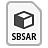
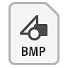
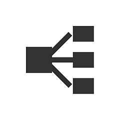
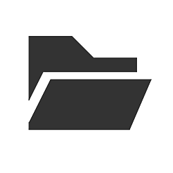

# Panoramica

[Substance 3D Designer](https://www.adobe.com/products/substance3d-designer.html) è un&#39;applicazione progettata per la creazione di texture, materiali e filtri 2D in un&#39;interfaccia basata su nodi, con particolare attenzione alla generazione di procedurali, alla parametrizzazione e ai flussi di lavoro non distruttivi. Si tratta dell&#39;applicazione più longeva dell&#39;ecosistema Substance 3D e le risorse che ne derivano sono le più versatili e dinamiche possibili.

Ecco come viene confrontato con altre applicazioni:

|                                          | 

  Substance 3D Sampler | 

  Substance 3D Painter | 

  Substance 3D Designer |
|------------------------------------------|------------------------------------------------------------------------------------------------------------------------------------------------------------------------------------------------------------------------------------------------------------------------------------------------------------------------------------------------------------------------------|----------------------------------------------------------------------------------------------------------------------------------------------------------------------------------------------------------------------------------------------------------------------------------------------------------------------------------|----------------------------------------------------------------------------------------------------------------------------------------------------------------------------------------------------------------------------------------------------------------------------------------------------------------------------------------------------------------------|
| **Curva di apprendimento** | Basso | Medio | Alta |
| **Materiali per autori** | Sì | Sì | Sì |
| **Crea modelli 3D** | No | Limitato\* | Limitato\* |
| **Filtri, pattern ed effetti per autori** | No | Limitato | Sì |
| **Esporta contenuto parametrico** | No | No | Sì |

\*: solo Spostamento. Vedere la funzionalità <b>Esportazione scena</b> nella sezione [vista 3D](../../interface/3d-view/3d-view.md).

In breve, Substance 3D Designer dovrebbe essere considerato l’applicazione di texture più tecnica e avanzata disponibile.

Consente di creare contenuti per quasi tutti i casi di utilizzo o scenari. Ciò significa che non sei limitato a un singolo tipo di output, come un materiale/set di texture univoco per una trama con mappatura UV, ma puoi creare contenuti per una serie di usi molto più estesa.

Ad esempio, la maggior parte dei contenuti avanzati procedurali in Painter e Sampler è stata creata ed esportata da Designer. Cose come Alpha di pennelli, generatori, filtri e Materiali di base possono essere tutte create in Designer.

## Flusso di lavoro

Substance 3D Designer è un editor basato su nodi che consente di creare contenuti in molti modi diversi con complessità variabili. [Il flusso di lavoro è ulteriormente illustrato nelle pagine dedicate](../../getting-started/workflow-overview/workflow-overview.md), ma i vantaggi derivanti dall&#39;utilizzo del software sono i seguenti:

**[Non lineare](../../compositing-graphs/substance-compositing-graphs.md):** puoi creare più output di texture contemporaneamente. Modifica una maschera o un cursore e ricalcola automaticamente qualsiasi output collegato. Non è più necessario creare separatamente mappe quali colore di base, rugosità, normale e così via.

**[Non distruttivo](../../compositing-graphs/compositing-graph-key-con/substance-compositing-graph-key-concepts.md):** puoi annullare qualsiasi azione *senza* perdere il tuo lavoro. Le iterazioni e le sperimentazioni risultano molto più rapide e la ricerca di flussi di lavoro ancora più efficienti.

**[esegue i baking integrata](../../bakers/bakers.md):** consente di accedere a strumenti di esegue i baking a trama avanzati e veloci direttamente all&#39;interno del software. Non è più necessario eseguire il baking in un software separato ed eseguire lunghi processi di importazione ed esportazione.

**[Parametrico](../../compositing-graphs/manage-parameters/exposing-a-parameter/exposing-a-parameter.md):** è possibile impostare il controllo di quasi tutti gli aspetti di una texture tramite un unico cursore o menu a discesa. Ciò consente di aggiungere un controllo e una variazione infiniti a una singola risorsa.

## Tipi di file

L&#39;applicazione e il relativo ecosistema utilizzano 4 diversi tipi di file. Per chiarezza, si tratta di tipi di file <b>esportati da Substance 3D Designer</b> che possono essere importati in alcune o in tutte le altre applicazioni Substance 3D.

<table>
<tr style="border: 0;">
<td style="border: 0;">

**File Substance 3D**\
(pacchetto)

`\*.sbs`

I file di Substance sono i **file di origine principali** per Designer. Quando apri un file di Substance, puoi **visualizzare e modificare tutti i nodi in un grafico**. Sono rappresentati come pacchetti, che possono contenere un numero qualsiasi di risorse come Grafici, Funzioni, Bitmap, Trame, ecc. Sono più difficili da condividere e meno veloci da calcolare. Possono essere aperti solo in Substance 3D Designer e nella Substance Player.

</td>
<td style="border: 0;">

**Archivio Substance 3D**

`\*.sbsar`

Gli archivi Substance sono <b> file Substance compilati e ottimizzati</b>. Sono molto più veloci da calcolare e possono essere facilmente condivisi senza problemi di riferimento. I parametri possono ancora essere modificati, ma la modifica del grafico è <b>bloccata</b>. Gli archivi Substance possono essere utilizzati in tutte le applicazioni Substance 3D e in tutte le applicazioni con [integrazione Substance 3D](https://experienceleague.adobe.com/en/docs/substance-3d/ecosystem/home) (alcune con un plug-in esterno), ad esempio Autodesk 3DS Max &amp; Maya, Unreal Engine o Unity Engine.

</td>
<td style="border: 0;">

{width="48px"}

**File statici**

`\*.tga, \*.bmp, \*.png, \*.fbx, \*.obj , ...`

Substance 3D Designer supporta sempre l’esportazione in tipi di file statici. Un&#39;immagine 2D può essere esportata in un file bitmap, un modello 3D può essere esportato nei tipi di file 3D più comuni. Quando viene esportato in file statici, **tutte le funzionalità dinamiche vengono perse**. Le immagini sono bloccate in risoluzione, i modelli 3D sono bloccati in conteggio multiplo.

</td>
</tr>
</table>

In genere, questo significa che manterrai il tuo lavoro nel formato SBS quando lavori in Designer, che esporterai in SBSAR se la destinazione lo supporta (Painter, ad esempio) o che utilizzerai file bitmap statici se non è necessario o non è supportato SBSAR.

## Tipi di risorse

I file Substance 3D possono contenere un’ampia gamma di risorse con scopi diversi. Alcune risorse possono essere create solo all’interno di Designer, altre provengono da applicazioni esterne.

<table>
<tr style="border: 0;">
<td width="16.67%" style="border: 0;">

[{width="150px"}](../../compositing-graphs/substance-compositing-graphs.md)

</td>
<td width="100.00%" style="border: 0;">

### Grafici Substance

I grafici a Substance consentono di generare ed elaborare *dati immagine 2D* e quindi di inviarli a uno o più output texture. In molti casi d’uso, un progetto ruoterà attorno a uno o più grafici a Substance.

[Vai alla sezione dedicata ai grafici Substance.](../../compositing-graphs/substance-compositing-graphs.md)

</td>
</tr>
</table>

<table>
<tr style="border: 0;">
<td width="16.67%" style="border: 0;">

[{width="150px"}](../../function-graphs/function-graphs.md)

</td>
<td width="100.00%" style="border: 0;">

### Substance grafici delle funzioni

<b>Le funzioni</b> sono un livello più elevato di astrazione e complessità: anziché elaborare i dati dell&#39;immagine (set di valori pixel), è possibile *elaborare valori singoli* (interi, a virgola mobile, vettoriali). Le funzioni vengono utilizzate quando si desidera eseguire operazioni più complesse o se si desidera regolare comportamenti specifici. Le funzioni in genere non funzionano in modo autonomo e non vengono utilizzate al di fuori del contesto dei grafici delle Substance.

[Vai alla sezione dedicata ai grafici delle funzioni Substance.](../../function-graphs/function-graphs.md)

</td>
</tr>
</table>

<table>
<tr style="border: 0;">
<td width="16.67%" style="border: 0;">

[{width="150px"}](../../resources/importing-linking-and-new/importing-linking-and-new-resources.md)

</td>
<td width="100.00%" style="border: 0;">

### Risorse non grafiche

Le risorse non grafiche possono provenire da applicazioni esterne (come Photoshop o Autodesk Maya), mentre alcune possono essere *create all&#39;interno di Designer*. La differenza principale è che non sono grafici basati su nodi; la maggior parte di essi sono elementi da utilizzare all&#39;interno o a fianco dei tipi di grafici sopra menzionati.

Esistono i seguenti tipi di risorse:

* [Bitmap](../../resources/bitmap-resource/bitmap-resource.md)
* [Grafica vettoriale (SVG)](../../resources/vector-graphics-svg-res/vector-graphics-svg-resource.md)
* [Scene 3D](../../resources/3d-scene-resource/3d-scene-resource.md)
* [Font](../../resources/font-resource/font-resource.md)
* [File AxF](../../resources/axf-appearance-exchange/axf-appearance-exchange-format.md)

</td>
</tr>
</table>
