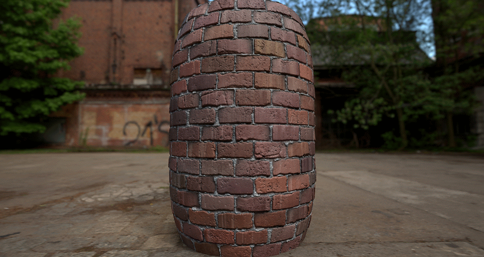

# Che cos&#39;è un file Substance 3D?

Un file di Substance 3D (`*.sbs`), noto anche come **pacchetto**, è un contenitore di risorse quali i grafici a Substance, che sono generatori dinamici di texture che possono essere esportati per essere utilizzati in molte applicazioni.

I grafici a Substance sono dinamici perché, a differenza di un file bitmap classico, l&#39;autore di un grafico a Substance può scegliere di **esporre i parametri** per fornire controlli sui risultati generati dal grafico.

Ad esempio, è possibile modificare in tempo reale la quantità di dust di un oggetto, il colore di una maglia della squadra di calcio o il motivo di un pavimento in pietra tagliata. La vostra immaginazione è virtualmente l&#39;unico limite.

Un pacchetto può essere *pubblicato* in un **file di archivio di Substance 3D** (`*.sbsar`) compilato e autonomo in modo che il grafico in esso contenuto possa essere utilizzato in applicazioni esterne per le quali esiste una [integrazione Substance](https://www.adobe.com/products/substance3d/plugins.html).

I grafici a Substance possono produrre texture che sono **100% procedurali**, con conseguenti dimensioni dei file del pacchetto molto leggere.

*Esempio di materiale da parete in mattoni realizzato da Käy Vriend.\
I parametri possono essere modificati per controllare dinamicamente l&#39;aspetto del materiale.*
