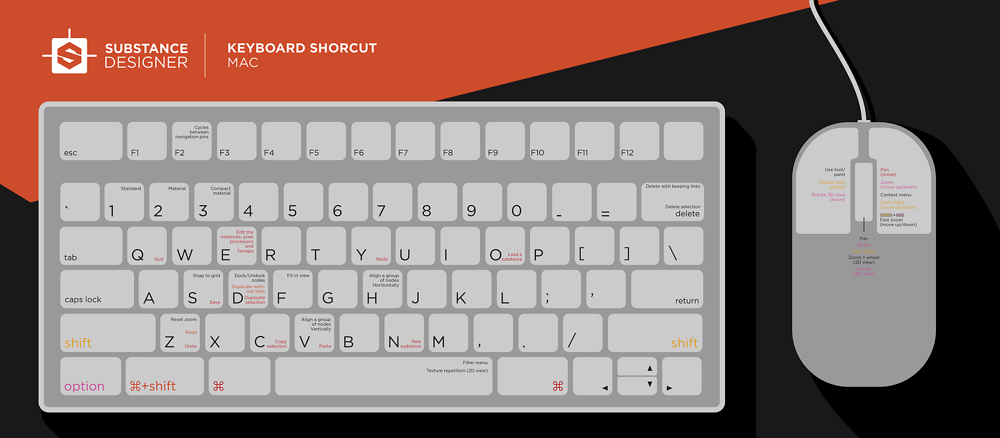

# Scelte rapide

In questa pagina puoi trovare una panoramica di tutte le scelte rapide per Substance 3D Designer.

## Keymap

**Windows**

{zoomable="yes"}

**macOS**

{zoomable="yes"}

## Elenchi di collegamenti

### Globale

| Azione | Windows | macOS |
|:-------------------------------------------------------------------------------------------------------------------|:----------|:------|
| [Nuovo grafico Substance](../../compositing-graphs/creating-compositing-gra/creating-a-substance-compositing-graph.md) | Ctrl + N | ⌘ + N |
| Carica pacchetto | Ctrl + O | ⌘ + O |
| Chiudi pacchetti selezionati | Ctrl + F4 | ⌘ + W |
| Salva pacchetto | Ctrl + S | ⌘ + S |
| Annulla | Ctrl + Z | ⌘ + Z |
| Ripristina | Ctrl + Y | ⌘ + Y |

{style="table-layout:fixed"}

### Visualizzazione grafico

**Viewport**

| Azione | Windows | macOS |
|:-----------------------------------------------------------------------------------|:---------------------------------------|:-------------------------------------|
| Zoom | Rotellina del mouse Alt + RMB + Trascina | Rotellina del mouse ⌥ + RMB + trascinamento |
| Zoom veloce | ⇧ + rotellina del mouse ⇧ + Alt + RMB + trascinamento | ⇧ + rotellina del mouse ⇧ + ⌥ + RMB + trascinamento |
| Panning | MMB + Drag Ctrl + RMB + Drag | MMB + Drag ⌘ + RMB + Drag |
| Ripristina zoom | Z | Z |
| Adatta alla visualizzazione | F | F |
| Copia | Ctrl + C | ⌘ + C |
| Incolla | Ctrl + V | ⌘ + V |
| Menu contestuale | RMB | RMB |
| Menu Nodo | Barra spaziatrice | Barra spaziatrice |
| Esegui ciclo di [segnaposti di navigazione](../../interface/the-graph-view/graph-items/graph-items.md) | F2 | F2 |

{style="table-layout:fixed"}

**Modalità di creazione del collegamento**

>[!NOTE]
>
> Scopri le modalità di creazione dei collegamenti in [questa pagina](../../interface/the-graph-view/link-creation-modes/link-creation-modes.md) di questa documentazione.

| Modalità | Windows | macOS |
|:-----------------|:--------|:------|
| Standard | 1 | 1 |
| Materiale | 2 | 2 |
| Materiale compatto | 3 | 3 |

{style="table-layout:fixed"}

**Quando un oggetto è selezionato nel grafico**

| Azione | Windows | macOS |
|:------------------------------------|:-------------|:----------|
| Copia selezione | Ctrl + C | ⌘ + C |
| Duplica la selezione | Ctrl + D | ⌘ + D |
| Duplica senza collegamenti | Ctrl + ⇧ + D | ⌘ + ⇧ + D |
| Elimina la selezione | Elimina | Elimina |
| Eliminare la selezione e mantenere i collegamenti | ⌫ | ⌫ |
| Ancorare/disancorare il nodo | D | D |
| Disattiva nodo/i | ⇧ + D | ⇧ + D |

{style="table-layout:fixed"}

### Vista 2D

| Azione | Windows | macOS |
|:---------------------|:---------------------------------------|:-------------------------------------|
| Zoom | Rotellina del mouse Alt + RMB + Trascina | Rotellina del mouse ⌥ + RMB + trascinamento |
| Zoom veloce | ⇧ + rotellina del mouse ⇧ + Alt + RMB + trascinamento | ⇧ + rotellina del mouse ⇧ + ⌥ + RMB + trascinamento |
| Panning | MMB + Drag Ctrl + RMB + Drag | MMB + Drag ⌘ + RMB + Drag |
| Reimposta su scala 100% | Z | Z |
| Adatta alla visualizzazione | F | F |
| Attiva/disattiva visualizzazione affiancata | Barra spaziatrice | Barra spaziatrice |

{style="table-layout:fixed"}

### Vista 3D

| Azione | Windows | macOS |
|:---------------------------------------------------------|:--------------------------------|:-----------------------------|
| Videocamera Dolly (Pan avanti/indietro) | Rotellina del mouse Alt + RMB + Trascina | Rotellina del mouse ⌥ + RMB + trascinamento |
| Rotazione fotocamera | LMB + trascina | LMB + trascina |
| Telecamera per autocarri e piedistalli (orizzontale e verticale) | MMB + Drag Ctrl + RMB + Drag | MMB + Drag ⌘ + RMB + Drag |
| Ruota l&#39;ambiente | Ctrl + ⇧ + RMB | Ctrl + ⇧ + RMB |
| Passa temporaneamente ai controlli Point Light 1 | ⇧ (blocco) | ⇧ (blocco) |
| Luce punto orbita 1 | LMB + trascina | LMB + trascina |
| Luce Dolly Point 1 | RMB + trascina | RMB + trascina |

{style="table-layout:fixed"}
