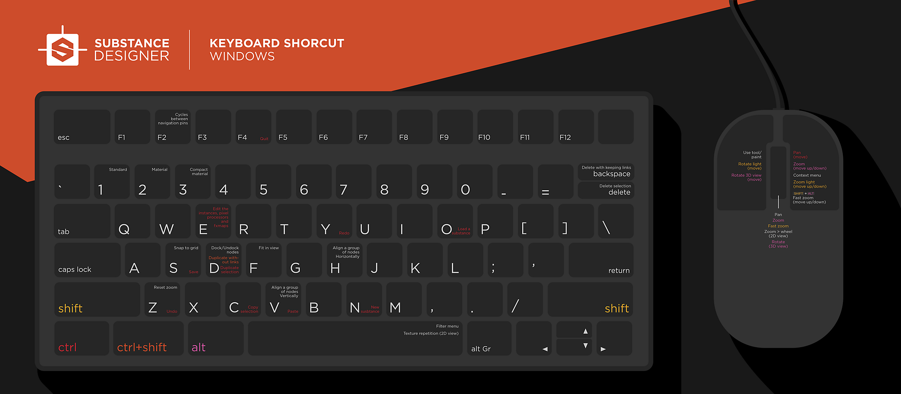
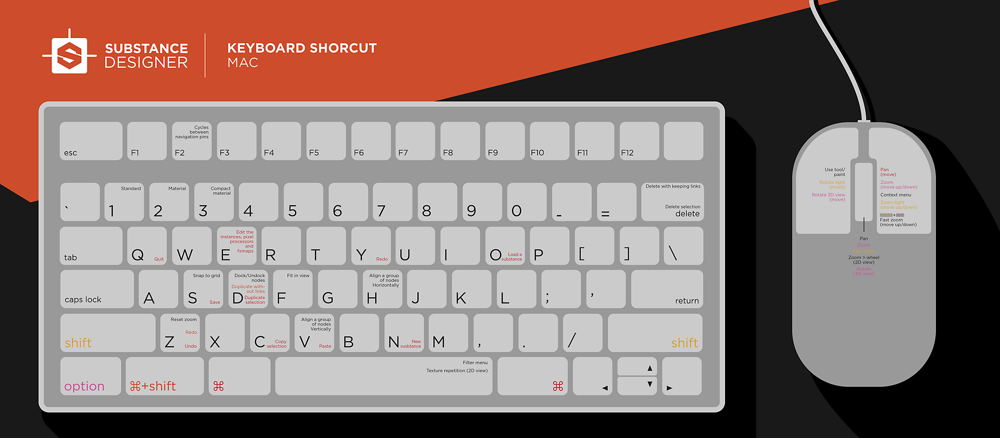

# Scelte rapide

In questa pagina puoi trovare una panoramica di tutte le scelte rapide per Substance 3D Designer.

## Keymap

**Windows**

{zoomable="yes"}

**macOS**

{zoomable="yes"}

## Elenchi di collegamenti

### Globale

| Azione | Windows | macOS |
|:------------------------|:-------------|:-------------|
| Nuovo grafico Substance | Ctrl + N | ⌘ + N |
| Carica pacchetto | Ctrl + O | ⌘ + O |
| Salva pacchetto | Ctrl + S | ⌘ + S |
| Salva tutti i pacchetti | Ctrl + ⇧ + S | ⌘ + ⇧ + S |
| Annulla | Ctrl + Z | ⌘ + Z |
| Ripristina | Ctrl + Y | ⌘ + Y |
| Menu contestuale | RMB | RMB |
| Ingrandisci ancoraggio | ⇧ + Barra spaziatrice | ⇧ + Barra spaziatrice |
| Motori di commutazione | F9 | F9 |
| Sospendi motore | ⇧ + Esc | ⇧ + Esc |

{style="table-layout:fixed"}

### Visualizzazione grafico

**Viewport**

| Azione | Windows | macOS |
|:----------------------|:---------------------------------------|:-------------------------------------|
| Zoom | Rotellina del mouse Alt + RMB + Trascina | Rotellina del mouse ⌥ + RMB + trascinamento |
| Zoom veloce | ⇧ + rotellina del mouse ⇧ + Alt + RMB + trascinamento | ⇧ + rotellina del mouse ⇧ + ⌥ + RMB + trascinamento |
| Panning | MMB + Drag Ctrl + RMB + Drag | MMB + Drag ⌘ + RMB + Drag |
| Ripristina zoom | Z | Z |
| Adatta alla visualizzazione | F | F |
| Copia | Ctrl + C | ⌘ + C |
| Incolla | Ctrl + V | ⌘ + V |
| Ricerca | Ctrl + F | ⌘ + F |
| Menu Nodo | Barra spaziatrice | Barra spaziatrice |
| Scorri segnaposti di navigazione | F2 | F2 |

{style="table-layout:fixed"}

**Creazione selezioni**

| Azione | Windows | macOS |
|:--------------------------|:-------------------|:---------------|
| Seleziona Aggiungi | Ctrl + A | ⌘ + A |
| Attiva/disattiva selezione | Ctrl + LMB | ⌘ + LMB |
| Selezione selezione (Aggiungi) | Ctrl + LMB + trascina | ⌘ + LMB + trascina |
| Selezione selezione selezione (Sottrai) | Maiusc + LMB + Trascina | ⇧ + LMB + Trascina |

{style="table-layout:fixed"}

**Su elementi selezionati**

| Azione | Windows | macOS |
|:------------------------------------|:-------------|:----------|
| Copia selezione | Ctrl + C | ⌘ + C |
| Duplica la selezione | Ctrl + D | ⌘ + D |
| Duplica senza collegamenti | Ctrl + ⇧ + D | ⌘ + ⇧ + D |
| Elimina la selezione | Elimina | Elimina |
| Eliminare la selezione e mantenere i collegamenti | ⌫ | ⌫ |
| Ancorare/disancorare il nodo | D | D |
| Adatta alla visualizzazione | F | F |
| Apri grafico di riferimento | ⌘ + E | ⌘ + C |
| Allineare i nodi in orizzontale | H | H |
| Allinea i nodi verticalmente | V | V |
| Allineare i nodi alla griglia | S | S |

{style="table-layout:fixed"}

**Connessioni nodo**

| Azione sul connettore | Windows | macOS |
|:---------------------|:-----------|:--------|
| Sposta connessione | ⇧ + LMB | ⇧ + LMB |
| Nuovo da stessa origine | Ctrl + LMB | ⌘ + LMB |
| Elimina connessione | Alt + LMB | ⌥ + LMB |

{style="table-layout:fixed"}

| Azione sul collegamento | Windows | macOS |
|:---------------------------------|:----------|:--------|
| Cambia collegamenti (2 collegamenti alla volta) | X | X |
| Aggiungi nodo punto | Alt + LMB | ⌥ + LMB |

{style="table-layout:fixed"}

#### Substance solo grafici

| Azione | Windows | macOS |
|:--------------------------------|:----------|:--------|
| Visualizzazione rapida in vista 2D (su nodo) | Alt + LMB | ⌥ + LMB |
| Disattiva nodo/i | ⇧ + D | ⇧ + D |
| Esportare gli output del grafico | Ctrl + B | ⌘ + B |
| Cancella cache nodi | F5 | F5 |
| Annulla rendering grafico | Esc | Esc |

{style="table-layout:fixed"}

| Modalità di creazione del collegamento | Windows | macOS |
|:--------------------|:--------|:------|
| Standard | 1 | 1 |
| Materiale | 2 | 2 |
| Materiale compatto | 3 | 3 |

{style="table-layout:fixed"}

>[!NOTE]
>
> Scopri le modalità di creazione dei collegamenti in [questa pagina](../../interface/the-graph-view/link-creation-modes/link-creation-modes.md) di questa documentazione.

### Vista 2D

| Azione | Windows | macOS |
|:---------------------|:---------------------------------------|:-------------------------------------|
| Zoom | Rotellina del mouse Alt + RMB + Trascina | Rotellina del mouse ⌥ + RMB + trascinamento |
| Zoom veloce | ⇧ + rotellina del mouse ⇧ + Alt + RMB + trascinamento | ⇧ + rotellina del mouse ⇧ + ⌥ + RMB + trascinamento |
| Panning | MMB + Drag Ctrl + RMB + Drag | MMB + Drag ⌘ + RMB + Drag |
| Reimposta su scala 100% | Z | Z |
| Adatta alla visualizzazione | F | F |
| Attiva/disattiva visualizzazione affiancata | Barra spaziatrice | Barra spaziatrice |

{style="table-layout:fixed"}

### Vista 3D

| Azione | Windows | macOS |
|:-----------------------------------------------------|:--------------------------------|:-----------------------------|
| Videocamera Dolly (Pan avanti/indietro) | Rotellina del mouse Alt + RMB + Trascina | Rotellina del mouse ⌥ + RMB + trascinamento |
| Rotazione fotocamera | LMB + trascina | LMB + trascina |
| Telecamera per autocarri e piedistalli (piano laterale e verticale) | MMB + Drag Ctrl + RMB + Drag | MMB + Drag ⌘ + RMB + Drag |
| Ruota l&#39;ambiente | Ctrl + ⇧ + RMB | Ctrl + ⇧ + RMB |
| Passa temporaneamente ai controlli Point Light 1 | ⇧ (blocco) | ⇧ (blocco) |
| Luce punto orbita 1 | LMB + trascina | LMB + trascina |
| Luce Dolly Point 1 | RMB + trascina | RMB + trascina |
| Salva rendering | Alt+S | ⌥ + S |
| Copia il rendering negli Appunti | Alt+C | ⌥ + C |
| Ripristina posizione videocamera | R | R |
| Ripristina stato fotocamera | ⇧ + R | ⇧ + R |
| Seleziona trama (solo rasterizzatore e Pathtracer GPU) | ⇧ + LMB | ⇧ + LMB |
| Selezione fotogramma | F | F |

{style="table-layout:fixed"}

### Explorer

| Azione | Windows | macOS |
|:----------------------------------|:----------|:-------|
| Chiudi pacchetti selezionati | Ctrl + F4 | ⌘ + W |
| Ricarica pacchetto/risorsa | Ctrl + R | ⌘ + R |
| Rinomina risorsa | F2 | F2 |
| Elimina risorsa | Elimina | Elimina |
| Carica risorsa nell’editor/visualizzatore | Invio | Invio |
| Pacchetto selezionato da Publish per SBSAR | Ctrl + P | ⌘ + P |

{style="table-layout:fixed"}
