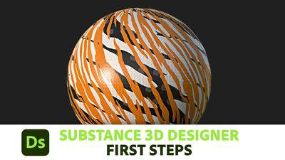
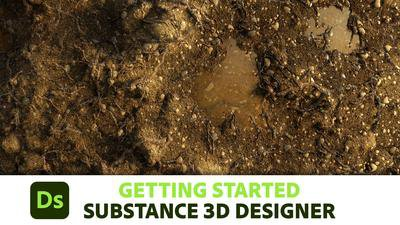
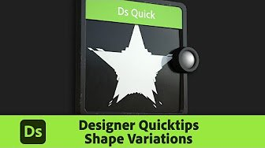
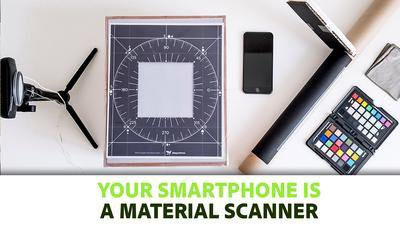

# Tutorials e apprendimento

La documentazione è intesa principalmente come riferimento tecnico completo. Se preferisci immergerti in video e altro materiale di apprendimento più mirato, questi tutorial sono utili per iniziare.

## Tutorial

|                                                                                                                                                                                                                                      |                                  |                                                                                                                                                                                                                                                                                                                                |
|:-------------------------------------------------------------------------------------------------------------------------------------------------------------------------------------------------------------------------------------|:---------------------------------|:-------------------------------------------------------------------------------------------------------------------------------------------------------------------------------------------------------------------------------------------------------------------------------------------------------------------------------|
| {width="200px"} | **Primi passi** | Una serie per principianti incentrata sui primi passi con Designer. Introduce l&#39;interfaccia utente, i concetti di base, quindi passa alle tecniche di base e infine spiega come esporre i parametri e creare un materiale completo.  È breve e mirato, ma mantiene la luce, rendendolo il miglior inizio per i principianti assoluti. |
| {width="200px"} | **Creazione del primo materiale** | Grande serie di video di partenza che ti guida attraverso l&#39;intero processo di creazione di un materiale esteso e completamente procedurale.  Ogni fase del processo è trattata e spiegata, in modo da imparare molto al termine, ma può essere intensa per i principianti assoluti. |
| {width="200px"} | **Suggerimenti rapidi** | Ogni video con suggerimento rapido si concentra su un insieme di nodi e tecniche delle dimensioni di un morso.  Vengono illustrati il risultato, i nodi e i parametri più importanti, quindi vengono illustrati alcuni modi per espandere l&#39;idea. |

## Articoli

|                                                                                                                                                                                                                                                                             |                                           |                                                                                                                                                                                                                   |
|:----------------------------------------------------------------------------------------------------------------------------------------------------------------------------------------------------------------------------------------------------------------------------|:------------------------------------------|:------------------------------------------------------------------------------------------------------------------------------------------------------------------------------------------------------------------|
| {width="200px"} | **Lo smartphone è uno scanner di materiali** | Articolo in-profondità che illustra l&#39;intero processo di acquisizione ed elaborazione delle foto tramite Designer.  Rappresenta un ottimo esempio di utilizzo di Substance 3D Designer per automatizzare determinate attività. |
