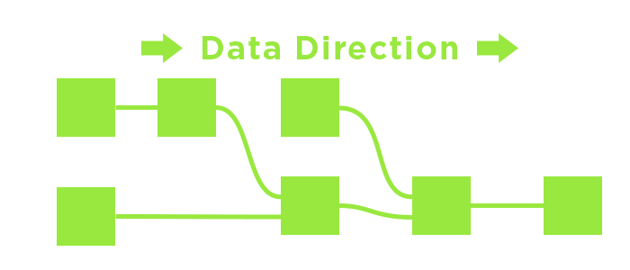
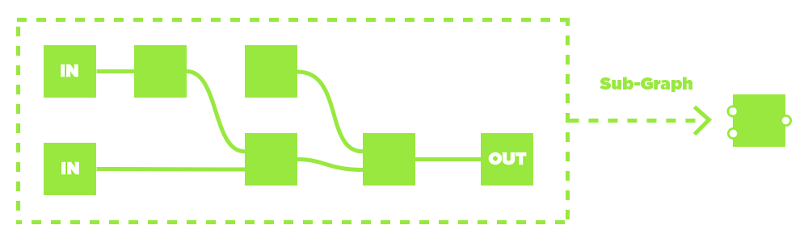
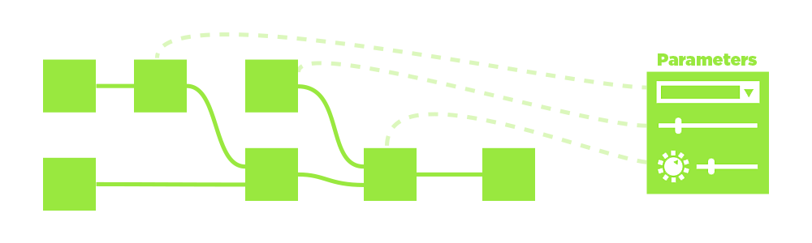
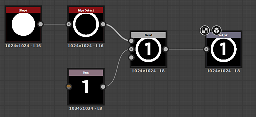
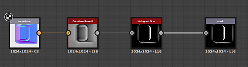
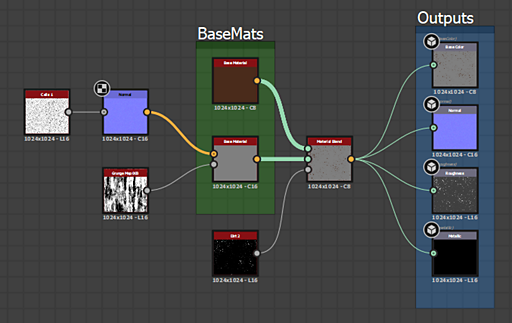
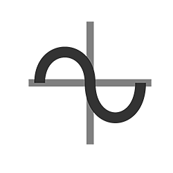
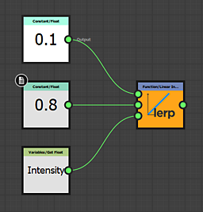
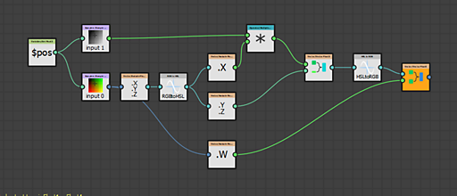

# Panoramica del flusso di lavoro

Substance 3D Designer è un editor basato su nodi. Ciò significa che quasi ogni tipo di progetto o risorsa comporterà l&#39;inserimento di nodi (blocchi costitutivi) e la loro connessione per creare una catena di operazioni (un grafico).\
Questa pagina spiega il concetto di flussi di lavoro basati su nodi e fornisce un riepilogo dei 3 tipi principali di grafici che è possibile creare in Designer.

{zoomable="yes"}

## Flusso di lavoro basato su nodi

L’utilizzo di Designer è diverso da quello di altri software di editing di immagini 2D, come Photoshop. Invece di eseguire un’azione manualmente (come regolare la saturazione selezionando un’opzione di menu e cambiando un cursore), dovete costruire i passaggi logici della modifica o della creazione dell’immagine. Questo avviene creando una rete di piccoli blocchi costitutivi chiamati &quot;nodi&quot;. I dati delle immagini vengono spostati da <b> a sinistra a destra</b> attraverso i blocchi predefiniti, collegati da collegamenti che determinano il percorso delle informazioni. Ogni nodo, se connesso, contribuirà ai risultati finali.

Il vantaggio principale è che il flusso di lavoro diventa **non lineare**: a differenza delle azioni eseguite manualmente che vengono inserite in uno stack di cronologia, potete sempre scambiare o modificare un nodo in qualsiasi momento.
Se decidete che la vostra primissima regolazione Contrasto che influisce sul risultato finale è stata troppo intensa, potete comunque tornare indietro e regolarla o addirittura ritagliarla completamente senza perdere tutto il lavoro eseguito successivamente.

## Flusso di lavoro dell’istanza del grafico

L’istanza dei grafici è un processo chiave in Designer. Consente di creare nodi personalizzati creando un pacchetto di un grafico o di una sua parte come nodo riutilizzabile. Questi sono chiamati [nodi di istanza](../../compositing-graphs/creating-compositing-gra/graph-instances-sub-gra/graph-instances-sub-graphs.md) e consentono di lavorare in modo più efficiente riutilizzando i grafici.\
Per esempio: Hai sviluppato una tecnica eccellente per l&#39;usura dei bordi? Dividete tutto questo in un grafico separato e riutilizzatelo in altri progetti.

Per ulteriori informazioni sulle istanze dei grafici, è disponibile una [sezione dedicata](../../compositing-graphs/creating-compositing-gra/graph-instances-sub-gra/graph-instances-sub-graphs.md) sul loro utilizzo in [Substance grafici](../../compositing-graphs/substance-compositing-graphs.md).

{zoomable="yes"}

## Parametri personalizzati

Qualsiasi nodo nella catena di operazioni avrà una qualche forma di controlli: pulsanti, cursori, impostazioni che potrai modificare per influenzare il risultato finale.\
Se create un grafico secondario o desiderate esportare il file di Substance in un’altra applicazione, potete creare un &quot;pannello di controllo&quot; personalizzato per i vostri grafici, che consenta agli altri utenti di modificarli con un pannello di controllo completamente univoco.

Scopri il concetto generale dei parametri personalizzati [qui](../../compositing-graphs/compositing-graph-key-con/substance-compositing-graph-key-concepts.md) oppure accedi a profondità e [inizia a esporre i parametri](../../compositing-graphs/manage-parameters/exposing-a-parameter/exposing-a-parameter.md).

## Tipi di grafici

Di seguito sono riportati un riepilogo dei tre tipi di grafici che è possibile modificare in Substance 3D Designer e un collegamento alla sezione pertinente della documentazione.

<table>
<tr style="border: 0;">
<td style="border: 0; width: 20%; vertical-align: top">

{width="120px"}

</td>
<td style="border: 0; vertical-align: top">

### Grafici Substance

[I grafici Substance](https://substance3d.adobe.com/) sono il tipo principale di grafico creato in Substance 3D Designer. Il loro scopo è <b>generare ed elaborare dati di immagini 2D</b> che non siano vincolati a una risoluzione, un colore o una forma impostata. Sono intesi come strumenti di elaborazione e generazione delle immagini estremamente versatili, non solo come risultati statici preimpostati.

I risultati possono presentarsi sotto forma di semplici pattern in bianco e nero, di filtri che vengono eseguiti solo su altre immagini e non generano contenuti di per sé, o anche di materiale procedurale completo con più canali.

I grafici a Substance sono [il tipo di grafico più supportato](../../getting-started/overview/overview.md) e possono essere esportati e utilizzati in numerosi flussi di lavoro diversi.

</td>
</tr>
</table>

#### Esempi

Di seguito sono riportati alcuni esempi tipici di casi d’uso comuni.

+++ Forma semplice

{width="512px" zoomable="yes"}

Una semplice forma maschera per una decalcomania viene creata generando[un testo](../../compositing-graphs/nodes-reference-for-com/atomic-nodes/text/text.md) e una [forma disco](../../compositing-graphs/nodes-reference-for-com/node-library/texture-generators/patterns/shape/shape.md), [estraendo il bordo](../../compositing-graphs/nodes-reference-for-com/node-library/filters/effects/edge-detect/edge-detect.md) dal disco e infine [unendoli](../../compositing-graphs/nodes-reference-for-com/atomic-nodes/blend/blend.md) prima di impostarli come [output](../../compositing-graphs/nodes-reference-for-com/atomic-nodes/output/output.md) finale.

Il testo con il numero o il thickness del bordo può essere esposto esternamente per rendere questo grafico più dinamico.

+++

+++ Filtro di regolazione

{width="512px" zoomable="yes"}

Un grafico di filtro prende una mappa normale come [input](../../compositing-graphs/nodes-reference-for-com/atomic-nodes/input-color/input-color.md) (con un&#39;anteprima personalizzata), [la converte in curvatura](../../compositing-graphs/nodes-reference-for-com/node-library/filters/effects/curvature-smooth/curvature-smooth.md) e quindi [regola il contrasto](../../compositing-graphs/nodes-reference-for-com/node-library/filters/adjustments/histogram-scan/histogram-scan.md) per creare una maschera di bordi convessi come [output](../../compositing-graphs/nodes-reference-for-com/atomic-nodes/output/output.md) finale.

I valori di contrasto impostati nell’istogramma possono essere esposti, rendendo questo un filtro semplice ma utile in combinazione con lo slot di input dinamico.

+++

+++ Materiale completo

{width="512px" zoomable="yes"}

Un grafico più complicato [fonde due Materiali di base](../../compositing-graphs/nodes-reference-for-com/node-library/material-filters/blending-material/material-blend/material-blend.md). Un [Materiale di base](../../compositing-graphs/nodes-reference-for-com/node-library/material-filters/pbr-utilities/base-material/base-material.md) è semplice, l&#39;altro utilizza alcuni input personalizzati per aggiungere interesse. Viene utilizzata una maschera per determinare quale dei due materiali viene visualizzato in una posizione prima di essere impostato come [output](../../compositing-graphs/nodes-reference-for-com/atomic-nodes/output/output.md) finale.

In questo esempio vengono utilizzate [modalità di creazione del collegamento](../../interface/the-graph-view/link-creation-modes/link-creation-modes.md) per semplificare l&#39;utilizzo di più collegamenti.

+++

<table>
<tr style="border: 0;">
<td style="border: 0; width: 20%; vertical-align: top">

{width="120px"}

</td>
<td style="border: 0; vertical-align: top">

### Substance grafici delle funzioni

Le funzioni elaborano **valori singoli** (numeri interi, valori mobili, vettori) anziché set di pixel (immagini). Anche le funzioni sono grafici a nodi, ma i [nodi coinvolti](../../function-graphs/nodes-reference-for-fun/function-nodes-overview/function-nodes-overview.md) e la loro interfaccia sono diversi dai grafici a Substance.

In effetti, il flusso di lavoro si basa su **operazioni matematiche e logiche**, il che rende il loro utilizzo in Designer molto più avanzato.

Le funzioni possono essere utilizzate in molti contesti diversi, i principali dei quali sono:
* Modifica del comportamento di [un parametro esposto](../../compositing-graphs/manage-parameters/exposing-a-parameter/exposing-a-parameter.md)
* Creazione del comportamento di [Elaboratori pixel](../../compositing-graphs/nodes-reference-for-com/atomic-nodes/pixel-processor/pixel-processor.md) o [FX-Maps](../../compositing-graphs/nodes-reference-for-com/atomic-nodes/fx-map/fx-map.md)
* Utilizzo di [valori](../../compositing-graphs/values-compositing-graphs/values-in-substance-compositing-graphs.md) al posto delle immagini nei grafici delle Substance, per scopi specifici

</td>
</tr>
</table>

#### Esempi

Di seguito sono riportati alcuni esempi da casi d&#39;uso comuni per i grafici delle funzioni Substance.

+++ Funzione semplice

{width="256px" zoomable="yes"}

Funzione semplice nel contesto di un parametro esposto. Ottiene un valore float di input chiamato &quot;Intensità&quot; che è determinato per andare da 0 a 1 (un intervallo facile da capire) e rimappa a un intervallo impostato di 0,1 - 0,8. Ciò significa che se l’utente imposta Intensità su 0, verrà utilizzato internamente 0,1, se l’interfaccia utente è impostata su 1, verrà utilizzato 0,8 e qualsiasi valore intermedio verrà interpolato linearmente. Questo tipo di funzione è in genere utilizzato quando si [espongono parametri](../../compositing-graphs/manage-parameters/exposing-a-parameter/exposing-a-parameter.md), ma si utilizzano funzioni personalizzate.

Questa funzione potrebbe anche essere scritta come `lerp(0.1, 0.8, Intensity)` in uno pseudocodice simile a HLSL o GLSL.

+++

+++ Funzione avanzata

{width="512px" zoomable="yes"}

Questa funzione avanzata mostra il funzionamento interno di un [processore pixel](../../compositing-graphs/nodes-reference-for-com/atomic-nodes/pixel-processor/pixel-processor.md) pensato per regolare la tonalità di un input della mappa colore in base all’intensità di un secondo input della maschera in scala di grigio.

Campiona entrambi gli input con la variabile di Alpha &quot;$pos&quot;, quindi rimuove l’input, converte il valore del colore in HSL e modifica il componente Tonalità moltiplicandolo per il valore della scala di grigi campionata. Successivamente riassembla il vettore, converte nuovamente l&#39;HSL in RGB e aggiunge nuovamente l&#39;Alpha per l&#39;output finale.

nello pseudocodice questa sarebbe una funzione molto più complicata che non si adatta a una singola riga.

+++
